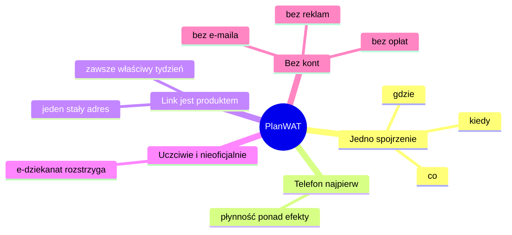

# Produkt

**Dla kogo jest PlanWAT, po co istnieje i czego nigdy nie zrobi.**

<!-- impeccable:product-schema 1 -->

## Platforma

web

## Użytkownicy

Studenci grup studyjnych WAT (Wojskowej Akademii Technicznej). Projekt zaczął się od jednej grupy, WCY26KY3S1 (Wydział
Cybernetyki, semestr zimowy 2026/27), a dziś obejmuje setki grup z wielu wydziałów i ma obejmować kolejne roczniki. Otwierają
go na telefonie, zwykle z linku z czatu grupy. Zadanie: dowiedzieć się, jakie zajęcia są teraz albo będą następne, gdzie się
odbywają (sala) i jak wygląda reszta tygodnia.

## Cel produktu

Szybki, projektowany najpierw pod telefon widok oficjalnego planu grupy WAT. Sukces to sytuacja, w której studenci otwierają
PlanWAT zamiast oficjalnego planu czy e-dziekanatu, kiedy chcą wiedzieć „co, kiedy, gdzie”. Link w czacie grupy zawsze
prowadzi do bieżącego tygodnia.

## Pozycjonowanie

Oficjalny plan WAT to duża tabela zbudowana pod pulpit. Ta strona zamienia te same dane w widok tygodnia, który dobrze czyta
się na telefonie. Pokazuje, co jest teraz i co za chwilę, a jeden stały link zawsze otwiera bieżący tydzień. Ma być też na
tyle przyjemna i ładna, żeby studenci woleli ją otwierać.

Plan zajęć jest publiczny, więc dostęp do niego nie wymaga żadnego konta. PlanWAT nie ma logowania, nie zbiera adresów e-mail ani żadnych
danych z e-dziekanatu, nie pobiera opłat za subskrypcję kalendarza i nie wyświetla reklam. Te cechy nie są dodatkiem, tylko częścią
produktu: gdyby któraś musiała zniknąć, znikałby sens projektu.

## Kontekst użycia

- Otwierany na telefonie, często w pośpiechu: między zajęciami, w drodze do budynku albo z czatu grupy.
- Ten sam adres jest udostępniany całej grupie i otwierany przez każdego, kto go ma. Serwis jest publiczny i nie ma logowania.
- Źródłem wiążącym w sprawie zmian i dodatkowych terminów pozostaje oficjalny plan i e-dziekanat. Strona odsyła do nich, gdy
  tydzień nie ma regularnych zajęć (sesja egzaminacyjna lub przerwa).
- Semestr zimowy 2026/27 trwa od 28.09.2026 do 22.02.2027, czyli 22 tygodnie. Plany są odświeżane automatycznie co noc.

## Możliwości i ograniczenia

- **Obecne możliwości:**
  - Nawigacja po tygodniach: strzałki, arkusz wyboru tygodnia, klawisze ←/→/T i przesunięcie palcem.
  - Otwarcie na bieżącym tygodniu ze znacznikiem „dziś” i skrótem „Bieżący tydzień”.
  - Karta „Teraz” na górze pokazuje trwające (lub następne dziś) zajęcia, salę i postęp. Dotknięcie przechodzi do zajęć.
  - Stany „Teraz” i „Następne” z odliczaniem w dzisiejszych zajęciach, ✓ przy każdych skończonych.
  - Postęp semestru, legenda przedmiotów podświetlająca przedmiot w całym tygodniu, numer spotkania („Wykład · 3/15”).
  - Okienka i czas przejścia między budynkami, z ostrzeżeniem, gdy przerwa jest krótsza.
  - Widoki: Tydzień, Lista, Miesiąc. Dwa semestry z przełącznikiem Zima / Lato.
  - „Moje przedmioty”: ukrywanie przedmiotów, których nie masz (zapis tylko w przeglądarce).
  - „Gdzie odrobić?”, „Porównaj grupy”, „Statystyki”, „Drukuj / PDF”.
  - Offline: Service Worker zachowuje otwarte strony i plany, a każdą grupę można zainstalować jak aplikację.
  - Subskrypcja kalendarza, w tym wariant z przypomnieniem 15 minut przed zajęciami (`plan-przypomnienia.ics`).
  - Mapa kampusu `/mapa/`: budynki według wydziałów, wyszukiwarka, trasa pieszo, miejsca wokół kampusu (przystanki, akademiki,
    stołówki, sklepy, paczkomaty, parkingi), dzień z planu otwarty na mapie.
  - Motyw jasny i ciemny: domyślnie według systemu, z przełącznikiem Auto / Ciemny / Jasny (zapis tylko w przeglądarce).
    Mapa pozostaje ciemna. Ciemny jest projektem referencyjnym.
  - Przewodnik po pierwszym otwarciu i przycisk „Jak korzystać”.
  - Podstawy publicznej strony: notatka o prywatności i zasady pod `/prywatnosc/`, „PlanWAT nigdy nie poprosi Cię o adres e-mail”
    w stopce, `robots.txt`, `/.well-known/security.txt`.
- **Terminologia** (zostaje po polsku): blok (jedna pozycja w planie), Wykład / Ćwiczenia / Laboratorium / Zaliczenie /
  Spotkanie organizacyjne, tydzień, sesja egzaminacyjna, e-dziekanat. Kody grup mają format WAT, np. `WCY26KY3S1`.
- **Technika:**
  - Plany leżą w `timetables/<semestr>/<GRUPA>.ics` (iCalendar, RFC 5545; format w `docs/ICS-FORMAT.md`). `build.py` je waliduje,
    wybiera bieżący semestr grupy po dacie i zapisuje `site/`: `/<GRUPA>/index.html` oraz `/<GRUPA>/plan.ics`, listę grup pod
    `/`, mapę i `404.html`. Strona grupy pobiera `plan.ics` i renderuje go w przeglądarce przez `src/ics.js`.
  - Grupa, wydział, semestr, zakres i data wygenerowania pochodzą z właściwości `X-PLAN-*`. Zajęcia używają `SUMMARY`
    (przedmiot), `CATEGORIES` (rodzaj), `LOCATION` (sala) i `X-PLAN-COLOR` (kolor przedmiotu).
  - `/<GRUPA>/plan.ics` jest publiczny, więc ten sam link działa jako subskrypcja kalendarza.
  - Plany odświeża codziennie crawler na własnym runnerze i publikuje przez gałąź `data` (patrz `docs/REFRESH.md`).
  - Docelowo GitHub Pages (repozytorium kilerdevs/PlanWAT). Można też użyć wzmocnionego kontenera nginx (`PLAN-WAT`,
    localhost:8088) za reverse proxy.
- **Bezpieczeństwo** (wyraźny wymóg właściciela: „możliwie najbezpieczniej, serwis publiczny”):
  - Rygorystyczne Content-Security-Policy z hashami skryptu i stylu. Jedyne zewnętrzne źródło to Google Fonts (strona mapy
    dodaje przypięty SRI MapLibre z unpkg i kafelki OpenFreeMap). `connect-src 'self'` pozwala pobierać tylko własny `plan.ics`.
  - Tylko żądania GET/HEAD, ograniczanie liczby żądań i standardowe nagłówki bezpieczeństwa.
  - Skrypty firm trzecich nie są zakazane z zasady, ale każdy musi mieścić się w CSP i być uzasadniony.
  - **Żadnych danych osobowych kadry** w planach, kodzie ani historii repozytorium.
- **Wydajność:** ma działać płynnie na zwykłych telefonach. Ciężkie efekty (rozmycie tła, ciągłe przerysowania, filtry na
  wielu elementach) powodowały lagi na telefonie właściciela. Bogaty ruch tylko na wydajnych urządzeniach, a preferencja
  ograniczonego ruchu jest szanowana.
- **Otwarte decyzje:**
  - Kto przygotowuje nowe kalendarze, gdy oficjalny plan się zmienia: dziś robi to crawler, ręczne poprawki idą pull
    requestem do `dev`.
  - Zdecydowane 2026-10-11: jeden adres na grupę (`/<GRUPA>/`), zawsze z bieżącym semestrem.

## Zobowiązania marki

- Nazwa: PlanWAT (repozytorium kilerdevs/PlanWAT, kontener PLAN-WAT). Publiczna domena nie jest wymieniona w repozytorium.
- Interfejs jest wyłącznie po polsku.
- Nieoficjalny projekt studentów: bez logo, herbu i sformułowań sugerujących, że to oficjalna strona uczelni.
- **PlanWAT jest darmowy i taki pozostanie.** Opiekun projektu zobowiązuje się do tego w stopce strony.

## Dostępne dowody

- Prawdziwe dane planu dla WCY26KY3S1: 22 tygodnie, 216 bloków z przedmiotami, rodzajami, salami i kolorami, w
  `timetables/2026-27-zima/WCY26KY3S1.ics`. Wyeksportowane jednorazowo przez `tools/export_ics.py` z pierwotnej strony,
  zachowanej jako `tests/fixtures/v1-page.html`. Wynik parsera dla tego kalendarza jest przypięty w
  `tests/fixtures/wcy26ky3s1.plan.json`.
- Nie istnieje i nie należy zmyślać: opinii, rekomendacji, liczb użycia ani materiałów dostarczonych przez WAT.

## Zasady produktu

1. **Jedno spojrzenie odpowiada na „co, kiedy, gdzie”.** Bieżący tydzień, trwające lub następne zajęcia i ich sala wyprzedzają
   wszystko inne.
2. **Telefon najpierw i płynnie.** Przyjemność nigdy nie kosztuje płynności przewijania ani czasu ładowania na zwykłym telefonie.
3. **Link jest produktem.** Jeden stały adres, otwarty z czatu, pokazuje właściwy tydzień każdemu, kto go otworzy.
4. **Uczciwie i nieoficjalnie.** To jawnie studencki widok oficjalnego planu, który w sprawach wiążących odsyła do e-dziekanatu.
5. **Bez kont i bez e-maila.** Plan jest publiczny, więc dostęp do niego nie wymaga logowania, a zbieranie adresów e-mail
   czy jakichkolwiek danych logowania nie ma żadnego uzasadnienia. Jeśli kiedyś PlanWAT zacznie o nie prosić, uznajcie, że to
   nie nasza strona.
6. **Rośnie bez utraty widoku jednej grupy.** Kolejne grupy i wydziały nie psują jednego, prostego spojrzenia.
