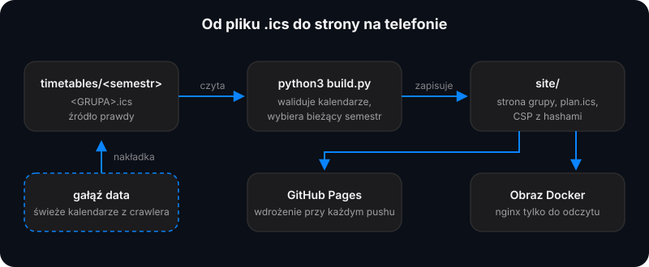
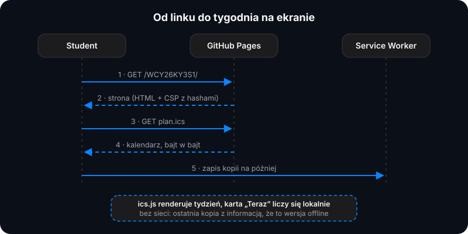
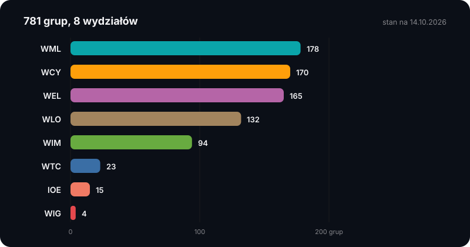
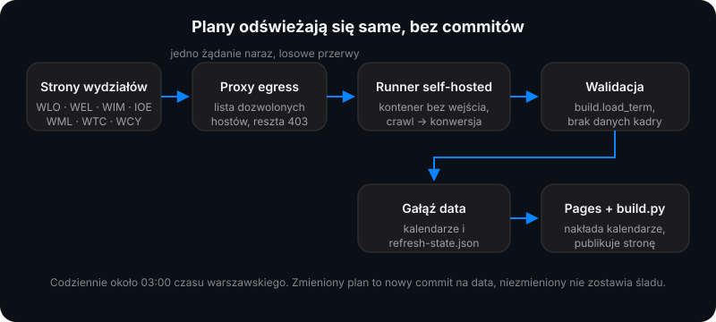
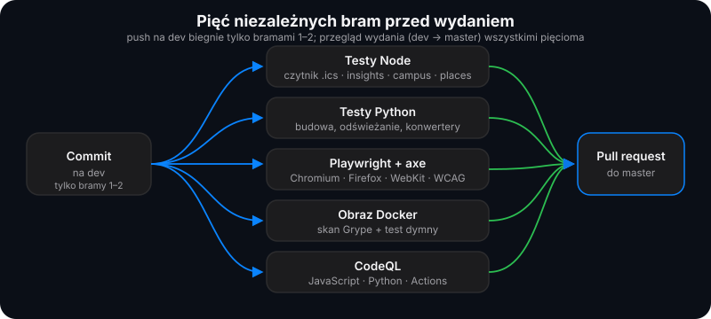

<div align="center">


# PlanWAT

**Nieoficjalny plan zajęć WAT, który czyta się na telefonie. Bez konta, bez e-maila, bez opłat.**

Jeden stały link dla każdej grupy zawsze otwiera bieżący tydzień. Widzisz, co jest teraz, co za chwilę i w której sali,
a plan możesz wpiąć do kalendarza w telefonie jedną subskrypcją. Wszystko powstaje z publicznych plików iCalendar.

[](https://github.com/kilerdevs/PlanWAT/actions/workflows/ci.yml)
[](https://github.com/kilerdevs/PlanWAT/actions/workflows/sast.yml)
[](https://github.com/kilerdevs/PlanWAT/actions/workflows/pages.yml)
[](LICENSE)
[](https://github.com/kilerdevs/PlanWAT/commits)
[](https://github.com/kilerdevs/PlanWAT/issues)


[**Szybki start**](#szybki-start) ·
[**Funkcje**](#funkcje) ·
[**Jak to działa**](#jak-to-działa) ·
[**Aktualizacja planów**](#automatyczna-aktualizacja-planów) ·
[**Bezpieczeństwo**](#bezpieczeństwo-i-prywatność) ·
[**Rozwój**](#rozwój) ·
[**Dziennik zmian**](CHANGELOG.md) ·
[**Polityka bezpieczeństwa**](SECURITY.md)

</div>

---

## Zastrzeżenie

> [!NOTE]
> PlanWAT to **nieoficjalny projekt studentów**. Nie jest związany z Wojskową Akademią Techniczną ani przez nią
> popierany i nie używa jej znaków. Wiążące w sprawie zmian i dodatkowych terminów pozostają oficjalny plan oraz
> e-dziekanat, a strona przypomina o tym w każdym tygodniu bez regularnych zajęć.

---

## Spis treści

| | |
|---|---|
| **Start** | [Przegląd](#przegląd) · [Dlaczego PlanWAT](#dlaczego-planwat) · [Szybki start](#szybki-start) · [Funkcje](#funkcje) |
| **Działanie** | [Jak to działa](#jak-to-działa) · [Pokrycie wydziałów](#pokrycie-wydziałów) · [Automatyczna aktualizacja planów](#automatyczna-aktualizacja-planów) · [Dodawanie lub poprawianie planu](#dodawanie-lub-poprawianie-planu) |
| **Wdrożenie** | [Wdrożenie](#wdrożenie) · [Dokumentacja](#dokumentacja) |
| **Jakość** | [Bezpieczeństwo i prywatność](#bezpieczeństwo-i-prywatność) · [Testy](#testy) · [Rozwój](#rozwój) |
| **Projekt** | [Struktura repozytorium](#struktura-repozytorium) · [Gałęzie i wydania](#gałęzie-i-wydania) · [Licencja](#licencja) |

---

## Przegląd

Oficjalny plan to wielka tabela zbudowana pod pulpit. PlanWAT zamienia te same dane w widok tygodnia, który dobrze
wygląda na telefonie, pokazuje, co dzieje się **teraz** i **za chwilę**, i daje każdej grupie jeden stały adres, który
zawsze prowadzi do bieżącego tygodnia.

<table>
<tr>
<td width="50%" valign="top">

**Dla studentów**
- Adres grupy w czacie grupy i gotowe: `…/<GRUPA>/`
- Karta „Teraz”: sala, godziny i postęp zajęć na żywo
- Numer spotkania (np. „Wykład · 3/15”), okienka i czas przejścia między budynkami
- Subskrypcja kalendarza (Google, Apple, link) z przypomnieniami 15 minut przed zajęciami
- Mapa kampusu 3D z akademikami, stołówkami, przystankami i paczkomatami
- Działa offline i da się ją zainstalować jak aplikację

</td>
<td width="50%" valign="top">

**Dla opiekunów**
- Plany to zwykłe pliki `.ics`, a źródłem prawdy jest repozytorium
- Codzienna, automatyczna aktualizacja ze stron wydziałów (bez commitów na `master`)
- Walidacja każdego kalendarza przed publikacją, brak danych kadry
- Statyczna strona z CSP przypiętym hashami, bez frameworków i trackerów
- Dwa sposoby wdrożenia: GitHub Pages albo obraz Docker z nginx
- Podgląd gałęzi `dev` pod adresem `/dev/`

</td>
</tr>
</table>

| | |
|---|---|
| Strona grupy | `https://kilerdevs.github.io/PlanWAT/<GRUPA>/`, np. [`/WCY26KY3S1/`](https://kilerdevs.github.io/PlanWAT/WCY26KY3S1/) |
| Plik kalendarza | `…/<GRUPA>/plan.ics`: pobierz albo zasubskrybuj w aplikacji kalendarza |
| Wszystkie grupy | [`https://kilerdevs.github.io/PlanWAT/`](https://kilerdevs.github.io/PlanWAT/): lista z wyszukiwarką i filtrem wydziałów |
| Mapa kampusu | [`…/mapa/`](https://kilerdevs.github.io/PlanWAT/mapa/) |

Interfejs jest po polsku. Kod i nazwy techniczne są angielskie, dokumentacja w tym repozytorium: polska.

---

## Dlaczego PlanWAT

Plan zajęć jest publiczny, więc nie ma czego chronić logowaniem. Są serwisy, które mimo to oferują konto (na przykład przez
kod wysyłany na adres studencki). Samo logowanie bywa opcjonalne, ale ta droga ma kilka słabych punktów, których u nas po
prostu nie ma:

| | **PlanWAT** | **Serwis z opcjonalnym logowaniem kodem na adres studencki** |
|---|---|---|
| Logowanie | **Nie ma i nie będzie** | Opcjonalne, ale po co, skoro plan jest publiczny |
| Co o Tobie wiemy | **Nic: ani adresu, ani konta** | Po zalogowaniu zweryfikowany adres e-mail powiązany z Twoją tożsamością, grupą i datami wizyt |
| Co wycieknie przy włamaniu | **Nie ma czego wykradać** | Lista adresów zalogowanych studentów z przypisanymi grupami |
| Phishing | **Nikt nie prosi Cię o kod, więc nie ma czego podrobić** | Przyzwyczaja do wpisywania kodów z poczty uczelnianej na stronie osoby trzeciej, czyli dokładnie tak, jak działają wyłudzacze |
| Obowiązki wobec RODO | **Żadne: nie zbieramy danych osobowych** | Zgody, polityka przetwarzania, obsługa próśb o wgląd i usunięcie danych |
| Eksport i subskrypcja kalendarza (`.ics`) | **Za darmo, dla każdego** | W części za abonamentem |
| Reklamy, śledzenie, cookies | **Brak** | Różnie |
| Cena | **0 zł, na zawsze** | Do ustalenia przy płatności |
| Kod źródłowy | **Otwarty, na licencji MIT** | Jak to działa i co dzieje się z danymi, trzeba przyjąć na słowo (trust me bro) |

> [!IMPORTANT]
> **PlanWAT nigdy nie poprosi Cię o adres e-mail**: ani studencki, ani prywatny, ani żaden inny, a także o hasło czy kod.
> Jeśli ktoś prosi o nie „w imieniu PlanWAT”, to szemrane zachowanie i warto je zgłosić. Zawsze możesz to sprawdzić
> samodzielnie: serwis nie ma żadnego formularza logowania i żadnego miejsca, w którym takie dane mogłyby zostać zapisane.

Opiekun projektu zobowiązuje się, że PlanWAT pozostanie darmowy dla wszystkich studentów. To zobowiązanie widnieje też
w stopce strony.

---

## Szybki start

**Jako student:** otwórz [stronę główną](https://kilerdevs.github.io/PlanWAT/), wpisz kod swojej grupy (np. `WCY26KY3S1`),
dotknij gwiazdki, żeby dodać grupę do ulubionych, i wyślij link do czatu grupy. Przy pierwszej wizycie pokaże się krótki
przewodnik. Można go wywołać ponownie przyciskiem **„Jak korzystać”**.

**Jako programista:**

```bash
git clone https://github.com/kilerdevs/PlanWAT.git
cd PlanWAT
git switch dev

python3 build.py                  # zbuduj site/ na dziś
node tests/e2e/serve.js           # podgląd: http://127.0.0.1:4173 (tak jak GitHub Pages)
```

> [!TIP]
> Do samego budowania wystarcza Python 3.12+ i biblioteka standardowa. Node.js jest potrzebny tylko do testów. Strona nie
> ma żadnych pakietów npm w środowisku uruchomieniowym.

---

## Funkcje

### Plan grupy

- **Karta „Teraz”**: zajęcia trwające teraz (albo następne dzisiaj), sala, godziny i postęp. Dotknięcie przeskakuje do
  zajęć w tygodniu.
- **Widok tygodnia**: na telefonie dzień to lista w grupie, na szerokim ekranie tydzień zamienia się w siatkę
  dzień × godzina. Minione dni i skończone zajęcia przygasają, a każde skończone zajęcia mają ✓.
- **Trzy widoki**: Tydzień, Lista (od dziś) i Miesiąc.
- **Nawigacja**: strzałki, przesunięcie palcem, klawiatura (`←` `→` `T` `Esc`), arkusz wyboru tygodnia i przycisk
  „Bieżący tydzień”. Telefon otwiera się na bieżących zajęciach.
- **Numer spotkania**: każde zajęcia pokazują, które to spotkanie z danego przedmiotu i rodzaju, np. „Wykład · 3/15”.
- **Okienka**: przerwa od 30 minut jest podpisana „Okienko”, także na siatce pulpitu. Między budynkami plan dolicza czas
  przejścia („Do bud. 65 · ~6 min pieszo”) i ostrzega, gdy przerwa jest krótsza.
- **Dwa semestry**: gdy grupa ma drugi semestr, pojawia się przełącznik Zima / Lato.
- **Moje przedmioty**: odznacz przedmioty, których nie masz (lektoraty, przedmioty do wyboru). Znikną z widoków,
  statystyk i pobranego `.ics`. Zapis tylko w przeglądarce.
- **Przedmioty**: legenda podświetlająca przedmiot w całym tygodniu oraz postęp (zajęcia odbyte z wszystkich).

### Narzędzia

Narzędzia są w trzech zakładkach pod tytułem planu: **Plan** (ulubione, moje przedmioty, jak korzystać, instalacja), **Eksport**
(pobranie `.ics`, kalendarz, udostępnianie, drukowanie) i **Analiza** (statystyki, porównanie grup, wolne sale, mapa planów).

- **Gdzie odrobić?** znajduje te same zajęcia (ten sam przedmiot, rodzaj i numer) w innych grupach rocznika i zaznacza
  terminy kolidujące z Twoim planem.
- **Porównaj grupy**: plany do czterech grup obok siebie i godziny, w których wszyscy mają wolne.
- **Wolne sale**: dzień, godzina, czas od 30 min do 3 h, budynek i numer sali; przy każdej sali pasek dnia z zajęciami i wolnym
  oknem, a „pokaż też sale wolne później” dopisuje te, które zwolnią się w ciągu dnia. To nie jest rezerwacja.
- **Mapa planów** (cztery zakładki: Twój plan, Mapa, Podobne, Metoda): „Współczynnik przejebania™” (0–100, jaka część
  porównanych planów jest lżejsza od Twojego), archetyp, to, co plan wyróżnia, mapa wszystkich planów z numerowaną listą
  archetypów, wyszukiwanie planu podobnego, lżejszego albo z mniejszą liczbą okienek i definicje wszystkich cech. Liczone w
  `profiles.py` z opublikowanych planów (PCA i k-średnie), bez uczenia modeli. To żart oparty na danych, nie ocena grupy.
- **Statystyki**: godziny w tygodniu, według dni i rodzajów zajęć, najwcześniejszy początek, najdłuższy dzień, okienka.
- **Kalendarz**: pobranie `.ics`, subskrypcja (Google, Apple przez `webcal`, link), wariant z przypomnieniem 15 minut
  przed zajęciami (`plan-przypomnienia.ics`), udostępnianie.
- **Drukuj / PDF**: jeden czysty arkusz A4 na tydzień, czarno na białym, jedna linia na zajęcia.
- **Ulubione i ostatnie grupy** na stronie głównej oraz informacja, że plan zmienił się od ostatniej wizyty. Zapis wyłącznie
  w pamięci przeglądarki.

### Mapa kampusu

Strona `/mapa/` pokazuje wszystkie budynki WAT na mapie 3D, pokolorowane według wydziałów.

- Wyszukiwarka budynków, wydziałów i miejsc, przełącznik 2D/3D, widok całego kampusu i trasa pieszo.
- Przy każdym dniu w planie jest przycisk „Mapa”, który pokazuje budynki zajęć tego dnia po kolei. Podkreślona sala
  otwiera mapę przy jej budynku.
- **Miejsca wokół kampusu** (z OpenStreetMap): przystanki tramwajowe i autobusowe, akademiki, Domki Radiowa, stołówki,
  bufety, restauracje, bary, sklepy, paczkomaty i parkingi, każde jako oznaczona ikona, z przełącznikami kategorii
  w panelu „Miejsca”.
- Zielone tereny, woda, rodzaje zabudowy i bryły 3D mają własną, spójną kolorystykę.

### Wygląd i dostępność

- **Motyw jasny i ciemny**: domyślnie według systemu, z przełącznikiem Auto / Ciemny / Jasny. Mapa zawsze jest ciemna.
- **Aplikacja offline**: Service Worker zachowuje otwarte strony i plany, a każdą grupę można dodać do ekranu głównego.
- **Przewodnik** przy pierwszej wizycie: osiem krótkich kroków z animowanymi przykładami (także „Znajdź wolną salę”).
- **WCAG 2.1 AA**: kontrast, obsługa klawiatury i czytników ekranu, szanowane `prefers-reduced-motion`.
- Bez frameworka, bez skryptów firm trzecich, płynnie na przeciętnym telefonie.

System wizualny („Apple, ale ciemny”) opisuje [DESIGN.md](DESIGN.md), a założenia produktu [PRODUCT.md](PRODUCT.md).

---

## Jak to działa



```
timetables/<semestr>/<GRUPA>.ics        źródło prawdy: jeden plik iCalendar na grupę i semestr
            │
            ▼  python3 build.py         waliduje każdy kalendarz, wybiera bieżący semestr grupy,
            │                           zapisuje strony z Content-Security-Policy przypiętym hashami
            ▼
site/index.html                         lista grup z wyszukiwarką (przekierowanie przy jednej grupie)
site/<GRUPA>/index.html                 strona planu
site/<GRUPA>/plan.ics                   bajt w bajt kopia kalendarza bieżącego semestru
site/<GRUPA>/plan-<semestr>.ics         drugi semestr grupy (jeśli istnieje)
site/mapa/index.html                    mapa kampusu
site/data/…                             lista grup i zajęcia z roczników: „Porównaj”, „Gdzie odrobić?” i „Wolne sale”
            │
            ▼  GitHub Pages             wdrożenie po każdym pushu na master i codzienna przebudowa,
                                        dzięki której nowy semestr startuje pierwszego dnia
```

W przeglądarce strona grupy pobiera `plan.ics` i renderuje go za pomocą [`src/ics.js`](src/ics.js), niewielkiego czytnika
RFC 5545 (składane linie, znaki specjalne, strefy czasowe, powtarzanie tygodniowe, wykluczone daty). Nic nie jest
generowane wcześniej do HTML, więc kalendarz i strona nie mogą się rozjechać. [`src/insights.js`](src/insights.js) liczy
statystyki, postęp, zmiany planu, wspólny wolny czas i zajęcia do odrobienia, a [`src/campus.js`](src/campus.js) i
[`src/places.js`](src/places.js) obsługują budynki i miejsca na mapie.



---

## Pokrycie wydziałów

Plany ze stron wydziałów są odświeżane automatycznie. Obecnie opublikowanych jest **781 grup**.



| Wydział | Grup | Sterownik | Uwagi |
|---|---:|---|---|
| WML | 178 | `wml` | strony Plansoft, aktualny `index.xml` odnajdywany przez ramkę strony głównej |
| WCY | 170 | `wcy` | lista grup z menu skoku; strony z planem poprzedniego semestru są pomijane |
| WEL | 165 | `plansoft` | wspólna polityka dostępu z WLO |
| WLO | 132 | `plansoft` | |
| WIM | 94 | `plansoft` | |
| WTC | 23 | `wtc` | plany w PDF konwertowane przez `pymupdf` |
| IOE | 15 | `plansoft` | zimowe plany leżą pod katalogiem `lato/`, siatka jest transponowana |
| WIG | 4 | ręcznie | pliki dodane do repozytorium |

Brakuje swojej grupy? Zgłoś [prośbę o plan](https://github.com/kilerdevs/PlanWAT/issues/new?template=timetable.yml) z kodem
grupy i linkiem do oficjalnego planu.

---

## Automatyczna aktualizacja planów



- Zaplanowany workflow co 2 godziny czyta strony wydziałów, konwertuje plany, **waliduje** je i wypycha wyłącznie zmienione
  kalendarze na gałąź `data`. Pages nakłada je na strony przed budową, więc **żaden commit na `master` ani `dev` nie jest
  potrzebny**.
- Crawler jest uprzejmy: jedno żądanie naraz, losowe przerwy, `robots.txt`, warunkowe pobieranie (`304`), ominięcie grup
  sprawdzonych niedawno. Po napotkaniu blokady wydział jest odkładany, a nie obchodzony.
- Każda strona grupy pokazuje **Zaktualizowano** (kiedy plan faktycznie się zmienił) i **Sprawdzono** (kiedy go ostatnio
  zweryfikowano).
- W sierpniu oraz od stycznia do lutego odświeżany jest także **nadchodzący semestr**, we własnym katalogu.
- Opublikowane kalendarze **nie zawierają danych kadry**: konwertery nie zapisują ani nazwisk, ani tytułów, a `build.py`
  odrzuca każdy kalendarz, który by je miał.

Szczegóły, w tym model zagrożeń dla samego runnera, opisuje [docs/REFRESH.md](docs/REFRESH.md).

---

## Dodawanie lub poprawianie planu

1. Umieść kalendarz w `timetables/<semestr>/<GRUPA>.ics`, np. `timetables/2027-lato/WCY26KY3S1.ics`.
   - `<semestr>`: małe litery, cyfry i myślniki. `<GRUPA>`: kod grupy WAT (litery, cyfry, podkreślenia).
   - Plik musi być w UTF-8 z zakończeniami linii CRLF (pilnuje tego `.gitattributes`).
2. Zastosuj [format kalendarza](docs/ICS-FORMAT.md): standardowe zdarzenia i kilka właściwości `X-PLAN-*` dla nagłówka.
3. Uruchom `python3 build.py` (odrzuci zły kalendarz i powie dlaczego) oraz `npm test`.
4. Otwórz pull request do gałęzi `dev`.

Grupa może mieć kilka semestrów. Budowa pokazuje semestr trwający w dniu budowy, między semestrami następny, a po ostatnim
najnowszy. Starsze semestry zostają w repozytorium jako historia.

Nie czujesz się pewnie z Gitem? Otwórz [zgłoszenie planu](https://github.com/kilerdevs/PlanWAT/issues/new?template=timetable.yml).

---

## Wdrożenie

| Sposób | Opis |
|---|---|
| **GitHub Pages** (docelowy) | [`pages.yml`](.github/workflows/pages.yml) buduje i wdraża po każdym pushu na `master` lub `dev`, codziennie i na żądanie. Produkcja zawsze powstaje z `master`, a `dev` jako podgląd pod `/dev/`. |
| **Docker** (własny hosting) | `docker compose up -d --build` buduje stronę w obrazie i serwuje ją z nginx tylko do odczytu, bez uprawnień roota, na `127.0.0.1:8088`, z nagłówkami bezpieczeństwa. |

Jak przenieść własną domenę na Pages i jak odtworzyć nagłówki, których Pages nie wysyła, opisuje
[docs/DEPLOYMENT.md](docs/DEPLOYMENT.md).

---

## Dokumentacja

| Dokument | O czym |
|---|---|
| [PRODUCT.md](PRODUCT.md) | Użytkownicy, cel produktu, ograniczenia i zasady |
| [DESIGN.md](DESIGN.md) | System wizualny: kolory, typografia, komponenty, ruch |
| [docs/ICS-FORMAT.md](docs/ICS-FORMAT.md) | Format kalendarza, który czyta PlanWAT |
| [docs/REFRESH.md](docs/REFRESH.md) | Automatyczna aktualizacja planów i model zagrożeń runnera |
| [docs/EGRESS.md](docs/EGRESS.md) | Proxy wyjściowe runnera |
| [docs/DEPLOYMENT.md](docs/DEPLOYMENT.md) | GitHub Pages, Docker, domena i nagłówki |
| [CONTRIBUTING.md](CONTRIBUTING.md) | Jak współtworzyć projekt |
| [SECURITY.md](SECURITY.md) | Zgłaszanie podatności |
| [CHANGELOG.md](CHANGELOG.md) | Dziennik zmian |

---

## Bezpieczeństwo i prywatność

- Każda strona ma **Content-Security-Policy z hashami**: uruchamia się tylko jej własny skrypt i styl, a pobierać może
  jedynie własne pliki. Jedynym zewnętrznym źródłem jest Google Fonts. Strona mapy dodatkowo ładuje MapLibre GL JS z
  `unpkg.com` (przypięty wersją i sumą SRI) oraz kafelki z `tiles.openfreemap.org`.
- Tekst z kalendarza trafia do strony wyłącznie przez `textContent`, a w budowie jest escapowany. Kolory przyjmowane są tylko
  jako `#rrggbb`.
- Service Worker buforuje tylko strony, kalendarze i pliki aplikacji z własnej domeny oraz Google Fonts.
- **Nie ma kont, adresów e-mail ani plików cookie.** Ulubione grupy, wybór motywu i ukryte przedmioty zapisują się wyłącznie w
  pamięci przeglądarki. Nic nie jest wysyłane do serwera, bo serwera nie ma.
- CI uruchamia CodeQL (JavaScript, Python, workflowy), skan obrazu Docker (Grype) i audyty zależności. Akcje są przypięte do
  skrótów commitów, a obrazy bazowe do digestów.
- Notatka o prywatności i zasadach korzystania: `/prywatnosc/` w serwisie.

Podatności zgłaszaj prywatnie. Zasady i terminy opisuje [SECURITY.md](SECURITY.md).

---

## Testy



| Warstwa | Narzędzie | Co sprawdza |
|---|---|---|
| Czytnik kalendarza | `node:test` | RFC 5545, strefy, powtarzanie, błędne dane |
| Logika planu | `node:test` | statystyki, postęp, porównanie grup, odrabianie, budynki i miejsca |
| Budowa i aktualizacja | `unittest` | walidacja kalendarzy, CSP, wybór semestru, crawler, konwertery |
| Przeglądarka | Playwright | pełne przepływy na zamrożonym zegarze, w trzech silnikach, na pulpicie i telefonie |
| Dostępność | axe-core | brak naruszeń WCAG w jasnym i ciemnym motywie |
| Obraz | Grype + test dymny | podatności i działanie kontenera |

---

## Rozwój

Wymagania: **Python 3.12+** (budowa, tylko biblioteka standardowa) oraz **Node.js 22+** (tylko testy).

```bash
npm ci                                  # narzędzia testowe: Playwright i axe-core
npx playwright install chromium         # raz; dodaj firefox webkit dla pełnej macierzy

python3 build.py                        # zbuduj site/ na dziś
npm run test:unit                       # czytnik (node:test) i testy budowy (unittest)
npm run build && npm run test:e2e       # testy przeglądarkowe na site/ z zamrożonym zegarem
npm test                                # wszystko powyższe
```

Konwencje i listę kontrolną pull requesta opisuje [CONTRIBUTING.md](CONTRIBUTING.md).

---

## Struktura repozytorium

```
build.py                  generator strony (tylko biblioteka standardowa)
src/group.html            szablon strony grupy: znaczniki, style i skrypt aplikacji (inline, z hashami CSP)
src/index.html, 404.html  lista grup i strona błędu
src/mapa.html             mapa kampusu (/mapa/)
src/ics.js                czytnik iCalendar
src/insights.js           statystyki, postęp, porównanie, odrabianie
src/campus.js             budynki kampusu, sala → budynek, wyszukiwanie
src/places.js             miejsca wokół kampusu (generowany z OpenStreetMap)
src/theme*.css, theme.js  motyw jasny i ciemny
src/sw.js                 Service Worker (tryb offline)
timetables/               <semestr>/<GRUPA>.ics: dane
tools/refresh/            crawler, konwertery i sterowniki wydziałów
tools/egress/             proxy wyjściowe runnera
tools/places/             generator src/places.js
tests/                    Node, Python i Playwright (e2e/)
deploy/nginx.conf         szablon nginx dla obrazu Docker
docs/                     dokumentacja i diagramy
```

---

## Gałęzie i wydania

- Praca trafia na **`dev`**, a wydania to pull requesty z `dev` do **`master`**, który wdraża produkcję.
- `master` wymaga **podpisanych commitów** i zielonych testów (jednostkowe, budowa, przeglądarkowe, obraz Docker, CodeQL).
- Zmiany opisuje [CHANGELOG.md](CHANGELOG.md) ([Keep a Changelog](https://keepachangelog.com/pl/1.1.0/), SemVer).

---

## Licencja

[MIT](LICENSE). Ikony pochodzą z [Lucide](https://lucide.dev) (ISC), krój Inter jest ładowany z Google Fonts (SIL OFL 1.1),
a dane mapy to © współtwórcy OpenStreetMap (ODbL). Szczegóły: [THIRD-PARTY-NOTICES.md](THIRD-PARTY-NOTICES.md).

<div align="center">

<sub>PlanWAT to nieoficjalny projekt studentów. Nie prosimy o Twój e-mail. Nigdy. Naprawdę.</sub>

</div>
