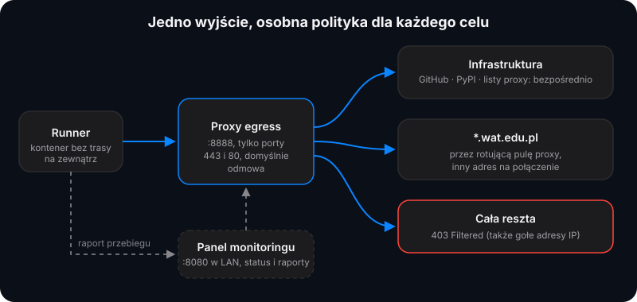

# Proxy wyjściowe (backend runnera)

**Jedno `HTTP_PROXY` dla runnera, z polityką dla każdego celu.**

-critical?style=flat)

Zastępuje rolę tinyproxy:

| Cel | Polityka |
|---|---|
| infrastruktura (GitHub, PyPI, listy proxy, … na równi z `allow.txt`) | bezpośrednie wyjście |
| wydziały (`*.wat.edu.pl`) | przez rotującą pulę publicznych proxy, inny adres wyjściowy na każde połączenie; hosty z listy `EGRESS_DIRECT_FACULTY` idą jednak bezpośrednio, bo to wyjścia puli dostają od nich blokady, a linia domowa serwuje je normalnie |
| cokolwiek innego | 403 (ta sama domyślna odmowa co w tinyproxy) |

Dlaczego pula mieszka tutaj, a nie w `refresh.py`: kontener runnera nie ma bezpośredniej trasy na zewnątrz, wszystko przechodzi
przez warstwę proxy, która odrzuca kodem 403 wszystko spoza listy dozwolonych (także gołe adresy proxy). Proces w runnerze
*nie może dotrzeć* do publicznych proxy, więc rotacja musi odbywać się w warstwie wyjścia. `refresh.py` potrzebował tylko
ponowień z odczekaniem (`--retries/--retry-backoff`) i raportu przebiegu dla GUI. Od 17.10.2026 crawl raportuje też blokady
(`POST /api/block`): w tunelu CONNECT proxy nie widzi strony blokady, ale crawler ją czyta, więc mówi proxy, którego celu
dotyczyła — a to wycofuje wyjście z ostatniego tunelu do tego hosta. Bez tego pula wierzyła, że oznaczone wyjście nadal działa
(tunel się przecież udał), i podawała je dalej, dopóki cały wydział nie stanął.

## Części

- `tools/egress/pool.py`: pula proxy (wzorzec z DeadDropMGMT). Pobiera te same 8 list proxy z GitHub (proxifly, monosans,
  thespeedx, roosterkid) i sprawdza kandydatów *przez nich samych*: Round 1 to neutralny kafelek OSM, Round 2 — strona indeksu
  wydziału. Zdrowy wynik to 200, odpowiedni rozmiar, dodatni znacznik treści i brak znanych stron blokad (WAF potrafi oddać
  duże 200), więc fałszywe „żywe” nie trafia do puli. Wybór sortuje ok → nowe → błąd według opóźnienia i zapisuje `pool.json`.
  Pula odświeża się co 4 h, sprawdza do 240 kandydatów na 32 wątkach i dorabia do 56 weryfikacji na host; uszkodzone proxy
  odpoczywają 10 minut, a po całkowitej awarii list mechanizm utrzymania wraca po 5 minutach, nie po 4 h. Samo niskie pokrycie
  hosta (np. WCY za WAF-em) uruchamia ponowne odświeżenie najwyżej co 10 minut, więc nie zapętla pobierania list i sond. Osiem niepowodzeń
  w 2 minuty wyłącza wyjścia tylko dla jednego hosta (sukces zdejmuje blokadę od razu), a wybór z warstwy zweryfikowanej
  rotuje między wyjściami — jedno szybkie proxy nie dostaje całego crawla, więc nie zostaje przez to oznaczone przez WAF.
  Wyjście zweryfikowane dla hosta szereguje jego własny wynik, nie pudła na innych wydziałach. Werdykty per host, blokady
  i wezwania do leczenia dotyczą tylko znanych hostów wydziałów: wymyślone nazwy `*.wat.edu.pl` od kodu zadania nie rozdmuchują
  puli ani nie wyłączają wyjść. Znaczniki czasu monotonicznego nie są wczytywane z `pool.json` (po restarcie maszyny
  „odpoczynek” liczy się od zegara ściennego).
- `tools/egress/server.py`: proxy przekazujące `:8888` (CONNECT i zwykłe HTTP, tylko porty 443/80, nazwa celu sprowadzona do małych
  liter bez kropki na końcu i odrzucana, gdy nie jest poprawną nazwą DNS) z łączeniem łańcuchowym
  HTTP/SOCKS5/SOCKS4a (w tym adresy IPv6 w odpowiedzi SOCKS5), plus GUI monitoringu w sieci LAN `:8080` (na hoście `:18080`,
  bo `:8080` zajmuje cAdvisor na hoście runnera) (`/` panel, `GET /api/status`, `POST /api/run` skrzynka raportów,
  `POST /api/block` zgłoszenie blokady (wycofuje wyjście), `POST /api/progress` postęp przebiegu na żywo, `GET /api/progress`
  jego podsumowanie dla GUI, `POST /api/refresh` wymuszenie odświeżenia — 409, gdy puli nie ma, `POST /login` logowanie
  przeglądarki). Żądania przyjmują `X-Token` albo `Authorization: Bearer $EGRESS_API_TOKEN` (crawler wysyła oba; spacje wokół
  wartości w `.env` się nie liczą). Z ustawionym tokenem chronione są też odczyty: panel, `GET /api/progress` i pełny
  `GET /api/status` (bez tokenu ten ostatni odpowiada tylko `{"ok":true,"auth":"required"}`, więc sondy i healthchecki działają
  dalej). Przeglądarka loguje się formularzem panelu i dostaje ciasteczko sesji (pochodne tokenu, `HttpOnly`,
  `SameSite=Strict`), które otwiera tylko odczyty — API POST zawsze wymaga tokenu w nagłówku. Bez tokenu API jest otwarte
  (egress ostrzega o tym w logu przy starcie), więc port GUI musi wtedy zostać na `localhost`. Token jest sprawdzany przed
  odczytem ciała, ciało ma sufit 256 KiB, a liczba połączeń jest ograniczona (proxy: `EGRESS_MAX_CONNECTIONS`, domyślnie 96;
  GUI: stałe 32). Tunel kończy się po 120 s ciszy (i najpóźniej po 600 s w ogóle) i zachowuje półzamknięcie, więc klient,
  który skończył wysyłać, wciąż odbiera całą odpowiedź.
- `Dockerfile.egress`, `requirements.txt` (curl_cffi, ta sama wersja co w odświeżaniu), `compose.fragment.yml` (fragment usługi
  do pliku compose plebanii).
- `tools/egress/prometheus-alerts.yml`, `tools/egress/blackbox-snippet.yml`: gotowy szablon alertów i sondy Blackbox dla
  Prometheusa na maszynie (jeszcze niepodłączony).

Polityka pustej puli to świadomy wybór operatora „fail-open”: ruch do wydziałów idzie bezpośrednio, a GUI pokazuje tryb DIRECT
(`PLANWAT_EGRESS_DIRECT_FALLBACK=1`). Ustaw `0`, by uzyskać „fail-closed” w stylu DeadDropMGMT (żądania do wydziałów dostają 403, aż pula
wróci do zdrowia). `EGRESS_FAIL_CLOSED` pozwala zawęzić to do wybranych hostów (nazwy rozdzielone przecinkami lub spacjami;
`1`, `true` albo `all` obejmuje wszystkie hosty `*.wat.edu.pl` jadące przez pulę, czyli spoza `EGRESS_DIRECT_FACULTY`): wpisany
host nigdy nie spada na linię domową, nawet przy fail-open — także wtedy, gdy ktoś wpisze go również na listę
`EGRESS_DIRECT_FACULTY` albo włączy `EGRESS_POOL=off` (wtedy wygrywa fail-closed, a egress ostrzega w logu przy starcie).
Wdrożenie produkcyjne wpisuje tam `planzajec.wcy.wat.edu.pl`, bo ten host jest blokowany właśnie z linii domowej i działa tylko
przez pulę. Bez zdrowego wyjścia taki host dostaje 403, a GUI pokazuje go jako `FAIL-CLOSED` (tryb puli
`FAIL-CLOSED (pula pusta)`), nie jako DIRECT.

Lista `EGRESS_DIRECT_FACULTY` (nazwy hostów rozdzielone przecinkami lub spacjami, ustawiana w `compose.yml`) wyłącza wybrane
hosty wydziałów z puli: wszystkie poza `planzajec.wcy.wat.edu.pl` idą bezpośrednio linią domową, bo publiczne wyjścia dostają od
nich blokady Incapsuli, a linia domowa serwuje je normalnie (WCY odwrotnie: jego blokuje linia domowa, więc zostaje na puli).
Host z listy pokazuje w GUI tryb `DIRECT (lista)`. Tylko hosty spoza tej listy są sprawdzane i weryfikowane przez pulę.
`EGRESS_POOL=off` to tryb wolontariusza: każdy host wydziału (także dodany później do `faculty_targets()`) idzie bezpośrednio
(w GUI `DIRECT (bez puli)`), a pula nie pobiera list, nie sonduje nikogo i nie wydaje żadnego wyjścia, nawet ze starego
`pool.json`. To przełącznik, a nie ręcznie przepisana lista hostów, która rozjeżdża się po dodaniu wydziału.

Ten sam obraz chroni crawlery wolontariuszy (`tools/volunteer/compose.volunteer.yml`, publikowany jako
`ghcr.io/kilerdevs/planwat-crawler-egress`): crawler stoi w sieci bez trasy na zewnątrz, a proxy z `EGRESS_POOL=off` (i, dla
starszych obrazów, wszystkimi hostami wydziałów na liście `EGRESS_DIRECT_FACULTY`) działa jako zwykła lista dozwolonych hostów:
bezpośrednio GitHub (`github.com`, `api.github.com`, `codeload.github.com`, `*.githubusercontent.com`), magazyn artefaktów
GitHub Actions (`*.blob.core.windows.net`), PyPI (`pypi.org`, `*.pythonhosted.org`) i `*.wat.edu.pl`, reszta 403. Zob. [WOLONTARIUSZE.md](WOLONTARIUSZE.md#instalacja-ręczna).

## GUI monitoringu

Domyślnie tylko z maszyny: `compose.fragment.yml` wiąże port z `127.0.0.1:18080` (kontener `:8080`), więc z innego komputera
otwórz tunel `ssh -L 18080:127.0.0.1:18080 <host>` i wejdź na `http://localhost:18080/`. Żeby otworzyć panel w LAN, zwiąż adres
LAN (`"<ip-lan>:18080:8080"`) i najpierw ustaw `EGRESS_API_TOKEN`; panel poprosi wtedy o token. Runner rozmawia z GUI przez sieć
wewnętrzną, której ten bind nie dotyczy.
Panel jest zbudowany w stylu resztę serwisu (te same tokeny motywu, ciemny oraz jasny z przełącznikiem Auto / Ciemny / Jasny
zapisywanym w przeglądarce) i odświeża się bez przeładowania co 4 s z `GET /api/status`. Pokazuje:

- kartę „Odświeżanie planów”: pasek postępu, licznik sprawdzonych grup, tempo (grup/s), przewidywany koniec i wiersz na każdy
  wydział z jego stanem (w kolejce, sprawdza, czeka na odblokowanie, zablokowany, brak postępu, gotowe).
- kartę „Egress”: czas działania, obsłużone żądania proxy, tunele w toku i odmowy (liczniki od startu kontenera) oraz tryb puli
  (ROTATING, DIRECT albo FAIL-CLOSED, gdy host bez awaryjnego wyjścia nie ma zdrowego proxy);
- tabelę „Wydziały”: wiersz na host z trybem (ROTATING / DIRECT (lista) / DIRECT (bez puli) / DIRECT / FAIL-CLOSED), liczbą
  potwierdzonych wyjść i połączeń
  awaryjnych, z podpowiedziami w nagłówkach kolumn;
- kartę „Pula proxy”: rozmiar, zdrowych i odrzuconych wychodów oraz p95 opóźnienia (w sekundach), a w nagłówku mediana,
  liczniki nowych wychodów i obejść; w tabeli adres, stan, ping, „pudła” (nieudane próby per host) i źródło; wiersz ma podpowiedź z czasem
  ostatniego sprawdzenia, a nagłówek tabeli zostaje na miejscu przy przewijaniu;
- „Przebiegi odświeżania”: ostatnie 10 raportów z czasem trwania i liczbą sprawdzonych oraz pominiętych grup, kodem wyjścia
  (raport bez kodu czyta się jako „nieznany”), a każdy wydział ma podpowiedź ze sprawdzonymi/zmienionymi/pominiętymi, przyczyną
  (blokady albo nieudanego wylistowania) i czasem oczekiwania. Kliknięcie wiersza rozwija szczegóły przebiegu — profil, czasy, kod wyjścia i tabelę wydziałów
  (sprawdzone, zmiany, pominięte, stan, czas oczekiwania na odblokowanie, kiedy) — a rozwinięcie przeżywa kolejne odświeżenia panelu.
  Karta postępu pokazuje wynik ostatniego przebiegu i odlicza do następnego (cron `:23` co 2 h): w bezczynności „następny ≈ 16:23
  (za 1 h 59 min)”, w trakcie przebiegu „następny za X”. Raporty są też zapisywane w `/data/runs.json`. Na wąskich ekranach
  (poniżej 640 px) wiersze przebiegów układają się w bloki, szczegóły przewijają się poziomo, a tabele wydziałów i puli chowają
  najmniej istotne kolumny („obejścia”, „źródło”).

Znaczniki czasu raportów są w UTC bez strefy — panel czyta je jako UTC i pokazuje w czasie lokalnym.

Karta postępu jest zbudowana z grubych zdarzeń, które crawler wysyła najlepszym wysiłkiem na `POST /api/progress`
(`PLANWAT_EGRESS_PROGRESS`, domyślnie `http://<egress-ip>:8080/api/progress`, puste wyłącza; `run_start`, `faculty_start`,
przycinane `tick`, `faculty_done`, `wait_start`/`wait_end`, `run_done`). Egress stempluje każdą dostawę i liczy tempo każdego
wydziału z jego własnych `tick`ów (okno 180 s, przy zbyt krótkiej historii — mediana tempa całego przebiegu), a przewidywany
koniec to suma tego, co zostało w najwolniejszej ścieżce (pasach wydziałów) plus minuta na publikację kalendarzy. Wydział,
który czeka na odblokowanie albo zamilkł, pokazuje „wstrzymane” zamiast wymyślonej godziny — jeden zgubiony `tick` psuje
tylko dokładność, nigdy sensu, a przebieg bez zdarzeń przez 10 minut czyta się jako „bez wieści”. Stanu nie zapisuje się na
dysku: raport końcowy wciąż ląduje w `/data/runs.json`. Raport „rozpoczęty”, po którym nie przyszło zakończenie, znika z panelu
po 12 h, więc zawieszony przebieg nie udaje wiecznie trwającego.

Sprawdzenie stanu: `GET /api/status` (200 = GUI działa, także bez tokenu; dodaj jako `healthcheck:` w compose, a samo
„unhealthy” nigdy nie restartuje kontenera, więc połącz z mechanizmem w stylu autoheal).

`refresh.py` raportuje najlepszym wysiłkiem przez sieć wewnętrzną (`PLANWAT_EGRESS_STATUS`, domyślnie
`http://<egress-ip>:8080/api/run`, puste wyłącza). Martwe GUI nigdy nie psuje crawla. Statystyki przebiegu dla wydziału
trafiają też do `refresh-state.json` (`faculties.<nazwa>.run`). Przebieg pogorszony, ale niezablokowany otwiera lub aktualizuje
zgłoszenie `zdegradowane` (zob. akcję odświeżania).

Alerty (szablon, jeszcze niepodłączony): `prometheus-alerts.yml` (egress nie działa 5 min: krytyczny, host utknął w DIRECT 2 h,
pula żywych < 5, dysk maszyny > 85%, runner offline) zasilany sondą `blackbox-snippet.yml` (`http_2xx`, 60 s,
`http://<host-egress>:18080/api/status`).

## Lista kontrolna wdrożenia (host runnera): NIE uruchamiać bez zgody

1. `scp -r tools/egress <użytkownik>@<host>:/opt/planwat-egress/` (wymaga SSH z hasłem: przełącz `PasswordAuthentication` w
   `/etc/ssh/sshd_config.d/00-hardening.conf` i `systemctl restart ssh`).
2. Wstaw `compose.fragment.yml` do `<katalog runnera>/compose.yml` (dodaje `egress` pod `<egress-ip>`, a tinyproxy zostaje
   nietknięty jako wycofanie). GUI jest związane z `127.0.0.1`; jeśli ma być widoczne w LAN, zmień bind na adres LAN i ustaw
   w `.env` `EGRESS_API_TOKEN` — ten sam, który widzi krok odświeżania (crawler wysyła go w `Authorization` i `X-Token`). Akcja odświeżania nie ustawia go jawnie, żeby
   pusta wartość nie nadpisała tokenu odziedziczonego z otoczenia runnera.
3. `docker compose up -d --build egress`, otwórz `:18080` (tunel SSH albo adres LAN) i poczekaj na odświeżenie puli → ROTATING.
4. Przełączenie: `HTTP_PROXY/HTTPS_PROXY/http_proxy/https_proxy` runnera → `http://<egress-ip>:8888` z `NO_PROXY` obejmującym
   podsieć wewnętrzną (`localhost,127.0.0.1,<inner-subnet>`, żeby zapytania GUI i statusu omijały proxy),
   `docker compose up -d runner`.
5. Uruchom mały przebieg (`--faculty wcy --limit 5 --dry-run`) i obserwuj tryb w GUI oraz tabelę przebiegów.
6. Wycofanie (przy jakichkolwiek wątpliwościach): skieruj runner z powrotem na `http://<proxy-ip>:8888`, `up -d runner`.

Zmiana `allow.txt` nie jest potrzebna: pobieranie list i sprawdzanie dzieje się wewnątrz kontenera egress na jego własnej
bezpośredniej trasie, a ruch odświeżania wciąż płynie przez jedno proxy „dozwolone w duchu”, które egzekwuje tę samą politykę.
