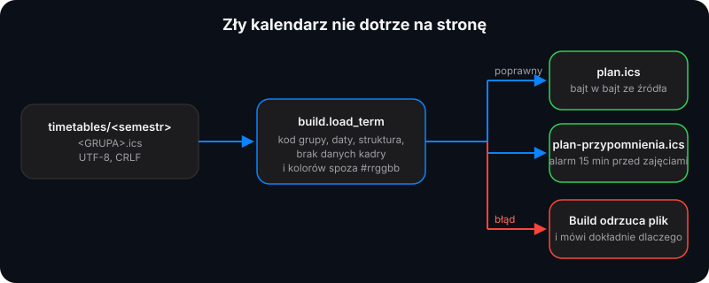

<div align="center">


# Format kalendarza

**Każdy plan to zwykły plik iCalendar.** Czyta go każda aplikacja kalendarza, a PlanWAT korzysta z kilku dodatkowych właściwości.

[](https://www.rfc-editor.org/rfc/rfc5545)
[](#plik)
[](#plik)
[](#właściwości-zdarzeń)

</div>

Każdy plan to standardowy plik iCalendar ([RFC 5545](https://www.rfc-editor.org/rfc/rfc5545)) w
`timetables/<semestr>/<GRUPA>.ics`.



## Plik

- UTF-8, zakończenia linii **CRLF**, linie składane po 75 oktetach (linie kontynuacji zaczynają się jedną spacją).
- `<GRUPA>` (nazwa pliku) to kod grupy WAT: 2–32 liter, cyfr i podkreśleń, np. `WCY26KY3S1`.
- `<semestr>` (katalog) to małe litery, cyfry i myślniki, np. `2026-27-zima`.

## Właściwości kalendarza

| Właściwość | Wymagana | Do czego służy |
|---|---|---|
| `X-PLAN-GROUP` | zalecana | Kod grupy w nagłówku. Musi być równy nazwie pliku. Wraca do `X-WR-CALNAME` bez wiodącego „Plan zajęć”. |
| `X-PLAN-FACULTY` | opcjonalna | „Wydział …” w nagłówku oraz sekcja na liście grup. Ukryta, gdy jej brak. |
| `X-PLAN-TERM` | opcjonalna | „Plan zajęć · semestr zimowy 2026/27”. |
| `X-PLAN-SEMESTER-START` | zalecana | Pierwszy dzień semestru (`RRRRMMDD`). Tygodnie zaczynają się od jego poniedziałku. Bez niej: pierwsze zajęcia. |
| `X-PLAN-SEMESTER-END` | zalecana | Ostatni dzień pokazany w nagłówku. Tygodnie sięgają jego tygodnia. Bez niej: ostatnie zajęcia. |
| `X-PLAN-GENERATED` | opcjonalna | „Wygenerowano …” w nagłówku. |
| `X-WR-CALNAME`, `X-WR-CALDESC`, `X-WR-TIMEZONE` | opcjonalne | Dla aplikacji kalendarza. |
| `REFRESH-INTERVAL`, `X-PUBLISHED-TTL` | opcjonalne | Jak często zasubskrybowane aplikacje pobierają kalendarz ponownie (np. `PT12H`). |

Tygodnie bez zajęć (święta, sesja) nadal pojawiają się między początkiem a końcem semestru, z adnotacją odsyłającą do
e-dziekanatu.

## Właściwości zdarzeń

| Właściwość | Wymagana | Do czego służy |
|---|---|---|
| `UID` | tak | Stała tożsamość dla aplikacji kalendarza. Zachowaj ją przy poprawianiu zajęć, np. `20261002T0800-wcy26ky3s1@planwat`. |
| `DTSTART`, `DTEND` (lub `DURATION`) | tak | Początek i koniec. Czasy lokalne z `TZID=Europe/Warsaw` są czytane jako czas ścienny, czasy UTC (`…Z`) są przeliczane. Zdarzenia całodniowe są ignorowane. |
| `SUMMARY` | tak | Nazwa przedmiotu, np. `Matematyka I`. Zdarzenia o tym samym `SUMMARY` dzielą kolor i wpis legendy. |
| `CATEGORIES` | zalecana | Rodzaj zajęć: `Wykład`, `Ćwiczenia`, `Laboratorium`, `Zaliczenie`, `Spotkanie organizacyjne`. Używana jest pierwsza wartość. |
| `LOCATION` | zalecana | Sala, np. `314 S`. |
| `X-PLAN-COLOR` | opcjonalna | Kolor przedmiotu jako `#rrggbb`. Cokolwiek innego wraca do stałego koloru z palety wyliczanego z nazwy przedmiotu. |
| `DESCRIPTION` | opcjonalna | Pokazywana przez aplikacje kalendarza. PlanWAT jej nie czyta. |
| `CONTACT` | **zabroniona** | PlanWAT nie przechowuje danych osobowych kadry: kalendarz z linią `CONTACT` albo opisem z nazwiskiem prowadzącego nie przejdzie budowy. |
| `RRULE` | opcjonalna | `FREQ=WEEKLY` lub `DAILY` z `INTERVAL`, `COUNT`, `UNTIL` i `BYDAY`. Inne reguły pokazują tylko pierwsze wystąpienie. |
| `EXDATE` | opcjonalna | Daty lub daty z godziną usunięte z powtarzanego zdarzenia. |
| `STATUS:CANCELLED` | opcjonalna | Zdarzenie jest pomijane. |

Wartości tekstowe używają escapowania iCalendar (`\,` `\;` `\\` `\n`).

Alarmy (`VALARM`) wewnątrz zdarzenia są ignorowane przez stronę. Budowa publikuje każdy kalendarz dwa razy: `plan.ics` oraz
`plan-przypomnienia.ics` z alarmem `DISPLAY` 15 minut przed każdym zdarzeniem, które go nie ma (zakończenia linii CRLF, linie
składane ponownie po 75 oktetach, `X-WR-CALNAME` z dopiskiem „ (przypomnienia)”).

W obu opublikowanych plikach `SUMMARY` ma po przedmiocie rodzaj zajęć w nawiasie i numer spotkania, np.
`Matematyka I (Wykład 3/15)`: trzeci z piętnastu wykładów, tak jak strona pokazuje „Wykład · 3/15”, bo aplikacje kalendarza
(także w subskrypcji) pokazują głównie tytuł. Rodzaj to pierwsza wartość `CATEGORIES`. Numer liczy zajęcia tego samego
przedmiotu i rodzaju w całym semestrze, po dacie i godzinie, zajęcia wpisane przez wydział dwa razy raz; zajęcia jednorazowe
mają sam rodzaj (`Matematyka I (Wykład)`), a okresy sesji numeru nie dostają. Zdarzenia bez `CATEGORIES` i tytuły zastępcze
(`-`) zostają bez zmian. W `timetables/` `SUMMARY` to sama nazwa przedmiotu: strona przy czytaniu pliku zdejmuje dopisek z
powrotem, więc kolory, „Moje przedmioty” i statystyki nadal grupują po przedmiocie. Pobrany ze strony plik `.ics` ma te same
tytuły.

## Przykład

```
BEGIN:VCALENDAR
VERSION:2.0
PRODID:-//PlanWAT//Plan zajęć//PL
X-WR-CALNAME:Plan zajęć WCY26KY3S1
X-PLAN-GROUP:WCY26KY3S1
X-PLAN-FACULTY:Cybernetyki
X-PLAN-TERM:semestr zimowy 2026/27
X-PLAN-SEMESTER-START:20260928
X-PLAN-SEMESTER-END:20270222
BEGIN:VTIMEZONE
TZID:Europe/Warsaw
...
END:VTIMEZONE
BEGIN:VEVENT
UID:20261005T0950-wcy26ky3s1@planwat
DTSTAMP:20260928T000000Z
DTSTART;TZID=Europe/Warsaw:20261005T095000
DTEND;TZID=Europe/Warsaw:20261005T112500
SUMMARY:Matematyka I
CATEGORIES:Wykład
LOCATION:314 S
X-PLAN-COLOR:#c14953
END:VEVENT
END:VCALENDAR
```

`timetables/2026-27-zima/WCY26KY3S1.ics` to kompletny, prawdziwy przykład (216 zajęć), a
[`tools/export_ics.py`](../tools/export_ics.py) pokazuje, jak taki plik powstaje.
