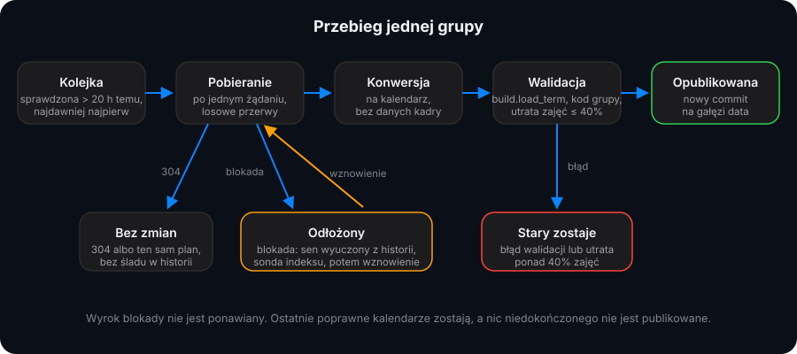

<div align="center">


# Automatyczna aktualizacja planów

**Plany są ponownie czytane ze stron wydziałów i publikowane bez commita na `master` ani `dev`.**

[](https://github.com/kilerdevs/PlanWAT/actions/workflows/refresh.yml)
-blue?style=flat)


</div>

Zaplanowany workflow GitHub Actions czyta strony wydziałów, konwertuje plany, sprawdza je i wypycha na gałąź `data`.
Workflow Pages nakłada te kalendarze na strony przy każdej budowie.


```
refresh.yml   co 2 godziny (`23 */2 * * *`), na własnym runnerze: crawl → konwersja → walidacja → push na `data`
gałąź data    timetables/<semestr>/<GRUPA>.ics oraz refresh-state.json
pages.yml     pobiera `data` i nakłada jej plany na prod/ i dev/ przed uruchomieniem build.py
```



## Jak zachowuje się przebieg

- Jedna sesja, jedno żądanie naraz, losowa przerwa między stronami (1,5–4 s na własnym runnerze, 4–9 s z `--profile hosted`),
  honorowany `robots.txt`, warunkowa rewalidacja (`If-Modified-Since` / `ETag` zapamiętane dla każdej grupy, więc niezmienione
  strony odpowiadają `304` bez treści) i pomijanie grup sprawdzonych mniej niż 60 minut temu (`--fresh-hours`), więc każdy
  dwugodzinny przebieg obejmuje wszystkie grupy. Wszystkie polityki Incapsula (`--lanes`, domyślnie 6) są przeglądane
  równolegle, każdy host we własnym tempie, więc pełny przebieg trwa krócej niż godzinę, a po zakończeniu przebiegu
  `pages.yml` od razu odbudowuje stronę (`workflow_run`).
- **Blokada odkłada wydział, nie kończy przebiegu.** Każdy status inny niż 200 (z wyjątkiem 304 i 404) albo strona incydentu
  Incapsula to najpierw odpowiedź blokady, nie wyrok: crawl zgłasza ją do proxy wyjściowego (które wycofuje wyjście, jakie ją
  przewiozło — w tunelu CONNECT proxy nie widzi strony blokady), a potem ponawia na świeżym połączeniu, czyli na innym wyjściu
  rotującej puli (`--block-retries`, domyślnie 2). Dopiero blokada, która przetrwa wszystkie próby, zawiesza wydział, podczas
  gdy pozostałe są obsługiwane, a potem odczekuje blokadę i wznawia od miejsca
  przerwania. Długość snu jest wyuczona dla każdej grupy polityki z poprzednich odbudowań (mediana, 20 min – 12 h, 2 h bez historii;
  epizody „ściany” ważą więcej niż niestabilne), odblokowanie jest sprawdzane tanimi pobraniami indeksu w rzadko-potem-gęsto
  rozłożonym harmonogramie (`--block-probes`, domyślnie 5, zawsze w ramach pozostałego budżetu), a całe oczekiwanie jest
  ograniczone (`--max-block-wait-minutes`, domyślnie 30, przy równoległych wydziałach każdy czeka osobno, a przy kolejnych dzielone sprawiedliwie: każde czekanie dostaje swój udział, ale co
  najmniej 15 min). Nic niedokończonego nie jest publikowane. Ostatnie poprawne kalendarze
  zostają, zgłoszenie GitHub otwiera się tylko wtedy, gdy przebieg kończy się wciąż zablokowany, a zadanie na własnym runnerze
  próbuje później ze stanu, który zapisał. (Znaczniki `_Incapsula_Resource` na dobrych stronach nie są blokadą.)
  Tylko przejściowe pobrania (błędy transportu, 408/425/429/500/502/503/504, pusty 200) są najpierw ponawiane z odczekaniem
  (`--retries/--retry-backoff`). Wyczerpanie odróżnia ścianę (`cause: wall`) od chwiejności
  (`cause: flaky`), a kolejka idzie od najdawniej sprawdzonych, więc przerwany przebieg zawsze obejmuje najdłużej niewidziane
  grupy. WLO i WEL dzielą jedną politykę Incapsula (`wat-edge`): jedno oczekiwanie obejmuje oba, potem każdy wznawia na własnej
  świeżej sesji. Wyuczony czas ochłodzenia zastąpił dawną stałą regułę 24–48 h (stan zachowuje przez ten czas ostatnie
  poprawne kalendarze).
- **Pogorszony przebieg mówi o tym głośno.** Pięć i więcej sprawdzeń z ponad 30% pominiętych albo grupa z listą mniejszą niż
  połowa poprzedniej (od 10 pozycji) oznacza wydział jako `degraded`: przebieg kończy się jako niepełny i eksportuje
  `degraded=true`.
- **Tempo i częstotliwość dostosowują się.** `--fresh-hours` (nadpisywalne dla wydziału, nigdy poniżej 1 h) zmniejsza się o
  połowę w sierpniu, styczniu i lutym, gdy wydziały publikują nadchodzący semestr. Przerwa między stronami skaluje się dla
  każdej grupy polityki (AIMD: ×1,5 przy blokadzie do 3×, ×0,9 przy czystym wydziale do 1×).
- Strona jest publikowana tylko wtedy, gdy kalendarz przechodzi własną walidację serwisu (`build.load_term`), nosi kod grupy
  swojego pliku i nie stracił więcej niż 40% zdarzeń. W przeciwnym razie stary kalendarz zostaje, a grupa trafia do logu.
- Kalendarz jest nadpisywany tylko wtedy, gdy plan się zmienił (data wygenerowania jest ignorowana), więc historia `data`
  pokazuje prawdziwe zmiany planu.

## Wydziały

Wydziały wymienia `tools/refresh/sources.json`. Każdy wskazuje sterownik w `tools/refresh/drivers/`:

| Wydział | Sterownik | Stan |
|---|---|---|
| WLO, WEL, WIM | `plansoft` | włączone |
| IOE | `plansoft` (przypięta baza: zimowe plany leżą pod nieaktualnym katalogiem `lato/`, siatka jest transponowana, a jej komórki odczytywane jako PRZEDMIOT/rodzaj/sala/alias, konwertowane przez `wlo2ics --faculty ioe`) | włączone |
| WML | `wml` (strony Plansoft, żywy `index.xml` rozpoznawany przez ramkę strony głównej, bo wydział publikuje ponownie w katalogach z rewizją) | włączone |
| WCY | `wcy` | włączone: zwykłe HTTP działa (sprawdzono 14.10.2026), a strony pokazujące inny semestr (lub pustą siatkę) są liczone jako „jeszcze nieopublikowane” — stare kalendarze zostają do publikacji nowego planu i nie oznaczają przebiegu jako pogorszony; stary kalendarz jest przed porównaniem przycinany do semestru, więc oczyszczenie pliku niosącego jeszcze lekcje poprzedniego lata nie jest czytane jako podejrzany skurcz planu |
| WTC | `wtc` | włączone: płaski `index.xml` (`/Plany/`) nazywa semestr, który wymienia (`<period>`), a sterownik publikuje PDF-y tylko dla odświeżanego semestru; konwersja przez `pymupdf` (instalowany przez akcję odświeżania) |

Każda grupa ma dokładnie jednego kanonicznego właściciela, więc żaden plan nie jest publikowany dwa razy pod dwoma kodami: WEL
pomija strony `IOE*` i `WME*`, które jego indeks też wymienia (należą do IOE i WIM), a IOE pomija wymienioną stronę `WME*`.

Strony nazwane jak `1PL26KP` dostają prefiks wydziału (`WEL1PL26KP`), żeby nazwa pliku, `X-PLAN-GROUP` i sekcja na stronie
głównej były spójne. Strony niebędące kodami grup (kursy, np. `Kurs_-_…`) są pomijane. Grupy WML zachowują własne kody `WMT`
wydziału (crawl obejmuje tylko strony `^WMT`) i są wyświetlane w sekcji WML. Grupy WIM zachowują swoje kody `WME` i są
wyświetlane w sekcji WIM.

Uwagi o WTC: serwis stoi za Incapsulą, a publiczne wyjścia puli dostają od niego blokady, podczas gdy linia domowa odpowiada
normalnie. Dlatego WTC — podobnie jak pozostałe wydziały poza WCY — jest na liście ruchu bezpośredniego proxy wyjściowego
(`EGRESS_DIRECT_FACULTY`, zob. docs/EGRESS.md), a przez pulę musi iść wyłącznie WCY. Indeks wydziału jest płaski
(`https://wtc.wat.edu.pl/Plany/index.xml`) i nazywa semestr, który wymienia; sterownik plikuje PDF-y tylko wtedy, gdy to
odświeżany semestr, a pobiera je z indeksem jako Referer, po jednym naraz. Konwerter wymaga `pip install pymupdf` na każdej
maszynie uruchamiającej crawl (codzienna akcja instaluje go do jednorazowego venv w `$RUNNER_TEMP`, bo wbudowany w runner
`/opt/venv` jest w trakcie zadania tylko do odczytu). Skonwertowane kalendarze nie zawierają nazwisk kadry (zob. zasadę
prywatności niżej).

## Bez nazwisk kadry w kalendarzach

Opublikowane kalendarze nie zawierają danych osobowych kadry: konwertery nigdy nie zapisują linii `CONTACT` ani linii z
prowadzącym (`Prowadzący:`). Nazwiska nauczycieli ze stron wydziałów są wyłącznie wynikiem pośrednim parsowania (sterują
podziałem na salę i nauczyciela) i są odrzucane, zanim kalendarz zostanie zapisany. `build.py` odrzuca każdy kalendarz, który
wymienia kadrę, więc regresja psuje budowę zamiast publikować nazwiska.

## Jednorazowa konfiguracja

1. Utwórz gałąź `data` z aktualnych poprawnych planów:
   `git switch --orphan data && git checkout dev -- timetables && git commit -m "Seed timetables" && git push -u origin data`
   (zostaw tylko kalendarze, które przechodzą `python build.py`).
2. Settings → Actions → General: zezwól GitHub Actions na tworzenie zgłoszeń i uruchamianie workflowów (uprawnienia workflowów
   „Read and write”) oraz ustaw „Fork pull request workflows” na wymaganie zatwierdzenia.
3. Wypróbuj: Actions → *Refresh timetables* → Run workflow, wydział `wim`.

## Własny runner (jedyny)

Ściana Incapsula na stronach wydziałów blokuje adresy centrów danych GitHub już przy pierwszym żądaniu (widziane przy pierwszym
przebiegu na hostowanym runnerze: `index.xml` odpowiedział 403), więc crawl działa wyłącznie na własnym runnerze, któremu
adres domowy pozwala przejść.

Runner nawiązuje tylko połączenia wychodzące do GitHub, a maszyna **nie potrzebuje żadnego otwartego portu przychodzącego**.
Każdy, kto może uruchomić workflow w repozytorium, może uruchomić kod na runnerze, więc:

- workflow uruchamia go tylko dla `schedule` i `workflow_dispatch` (nigdy dla pull requestów), a uruchamiać mogą tylko osoby z
  prawem zapisu;
- uruchamiaj go w kontenerze jako użytkownik bez uprawnień, bez montowań hosta, bez gniazda Dockera i bez żadnych sekretów poza
  własną rejestracją; zarejestruj go na poziomie repozytorium z etykietą `planwat`;
- zablokuj cały ruch przychodzący do hosta i zezwól na wychodzący wyłącznie do GitHub i hostów wydziałów.

## Gdyby sam GitHub został przejęty

Projekt zakłada, że repozytorium (kod, Actions, gałąź `data`, `GITHUB_TOKEN`) może wpaść w niepowołane ręce, podczas gdy host
runnera musi pozostać czysty, a opublikowana strona bezpieczna:

- Runner żyje w wewnętrznej sieci Docker bez trasy na zewnątrz, a jego jedyne wyjście to proxy, które zezwala na
  `CONNECT ...:443` wyłącznie do GitHub, PyPI i hostów wydziałów (cokolwiek innego, w tym gołe adresy IP, dostaje `403 Filtered`).
  Ukradziony token zadania nadal nie sięgnie bezpośrednio do serwera atakującego, a eksfiltracja ogranicza się do wypchnięcia do
  GitHub, co da się audytować w historii repozytorium.
- Token zadania ma tylko `contents:write` (push gałęzi `data`) i `issues:write` (zgłoszenie o blokadzie). Celowo nie ma
  `actions:write`: odświeżone kalendarze podbiera codzienna przebudowa `pages.yml`, więc skradziony token nie może uruchamiać ani
  zatwierdzać innych workflowów.
- `master` jest chroniony (podpisane commity, wymagane CI), a `pages.yml` buduje produkcję wyłącznie z `master`, nakładając
  kalendarze z `data`, z których każdy musi przejść walidację `build.load_term` i jest escapowany do stron z CSP przypiętym
  hashami. Zatruta gałąź `data` nie może więc wstrzyknąć skryptu ani wypromować treści do katalogu głównego: w najgorszym razie
  pokaże błędne godziny zajęć do czasu cofnięcia. Chroń też gałąź `data` (Settings → Branches → Add rule dla `data`: wymagaj
  pull requestów dla ludzi, pozwól obejść tylko botowi Actions), żeby przejęta sesja w przeglądarce nie mogła cicho wypchnąć na nią zmian.
- Runner nie przechowuje długo żyjących sekretów poza własną rejestracją, a jego katalog roboczy należy traktować jak
  jednorazowy: każdy, kto uruchomił na nim kod, mógł zostawić pliki. Preferuj runnery efemeryczne (jedno zadanie), a przy
  stałym czyść `/home/runner/_work` po zadaniach i w razie wątpliwości rejestruj ponownie ze świeżego tokenu.
- Obserwuj oznakę nadużycia runnera: niespodziewane pliki workflowów z `runs-on: [self-hosted, planwat]` albo zmiany
  `refresh.yml` / `.github/actions/refresh`. Alarmuj dla tych ścieżek regułą CODEOWNERS lub wymaganym przeglądem w ochronie gałęzi.

## Co pokazuje strona

Każda strona grupy pokazuje **Zaktualizowano** (kiedy plan ostatnio się zmienił) i **Sprawdzono** (kiedy crawler ostatnio go
zweryfikował), pobrane w czasie budowy z `refresh-state.json`. Grupy nigdy nieodświeżone pokazują własną datę wygenerowania z
kalendarza.

## Dwa semestry naraz

Wydziały publikują plany nadchodzącego semestru przed jego startem. W sierpniu (semestr zimowy) oraz od stycznia do lutego
(semestr letni) każdy przebieg odświeża więc najpierw trwający semestr, a potem nadchodzący, do jego własnego katalogu
`timetables/<semestr>/` (`core.upcoming_reference`). Nadchodzący semestr jest śledzony w `refresh-state.json` pod kluczem
`<GRUPA>@<semestr>`, więc daty „sprawdzono” i „zmieniono” trwającego semestru pozostają nietknięte. To, czego jeszcze nie
opublikowano, po prostu nie istnieje i nigdy nie sprawia, że przebieg jest niepełny. Kalendarz jest przyjmowany tylko wtedy,
gdy większość jego zajęć mieści się w oknie semestru (`core.term_window`), więc wydział, który wciąż pokazuje plan sprzed roku,
nie zostanie zapisany pod nowym semestrem.

Budowa publikuje każdy znaleziony semestr: strona grupy pokazuje trwający (lub następny) semestr, a gdy grupa ma jeszcze
jeden, przełącznik Zima / Lato (`?t=<semestr>`, kalendarz `plan-<semestr>.ics`).
