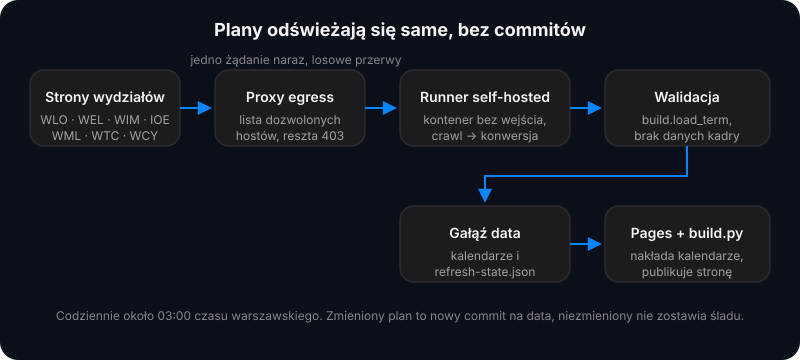
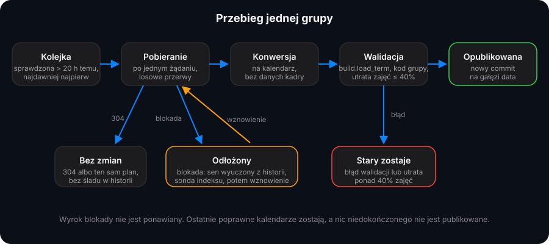

<div align="center">


# Automatyczna aktualizacja planów

**Plany są ponownie czytane ze stron wydziałów i publikowane bez commita na `master` ani `dev`.**

[](https://github.com/kilerdevs/PlanWAT/actions/workflows/refresh.yml)
-blue?style=flat)


</div>

Zaplanowany workflow GitHub Actions czyta strony wydziałów, konwertuje plany, sprawdza je i wypycha na gałąź `data`.
Workflow Pages nakłada te kalendarze na strony przy każdej budowie.



```
refresh.yml   co 2 godziny (`23 */2 * * *`), na własnych runnerach (wydziały dzielone między włączone): crawl → konwersja → walidacja → push na `data`
gałąź data    timetables/<semestr>/<GRUPA>.ics oraz refresh-state.json
pages.yml     pobiera `data` i nakłada jej plany na prod/ i dev/ przed uruchomieniem build.py
```



## Jak zachowuje się przebieg

- Jedna sesja, jedno żądanie naraz, losowa przerwa między stronami (1,5–4 s na własnym runnerze, 4–9 s z `--profile hosted`),
  honorowany `robots.txt`, warunkowa rewalidacja (`If-Modified-Since` / `ETag` zapamiętane dla każdej grupy, więc niezmienione
  strony odpowiadają `304` bez treści), pomijanie grup sprawdzonych mniej niż 60 minut temu (`--fresh-hours`) oraz rozciąganie
  przerwy przed następnym sprawdzeniem cichej grupy (`--adaptive-hours`, w akcji 4 h — niżej), więc w spokojnym semestrze
  przebieg zagląda do cichej grupy rzadziej niż co drugi raz. Wszystkie polityki Incapsula (`--lanes`, domyślnie 6) są przeglądane
  równolegle, każdy host we własnym tempie, więc pełny przebieg trwa krócej niż godzinę. Po zakończeniu przebiegu
  `pages.yml` (`workflow_run`, etap „rebuild needed?”) od razu odbudowuje stronę, gdy zmienił się choć jeden kalendarz.
  Przebieg, który zapisał tylko nowe godziny sprawdzeń (prawie każdy wypycha `refresh-state.json`), odbudowuje ją dopiero
  wtedy, gdy opublikowana wersja ma ponad 6 h (`STAMPS_MAX_HOURS`): „Sprawdzono” spóźnia się wtedy najwyżej o tyle, a
  strona nie jest wdrażana kilkanaście razy dziennie dla samej godziny. Przebieg, który nic nie wypchnął, nie wdraża nic.
  Wyjątek: przebieg, który skończył się inaczej niż poprzedni (inny wynik albo inne serwery, `history=new`), odbudowuje
  stronę od razu, żeby [`/stan/`](#historia-przebiegów) go pokazała.
- **Strona listy, której już nie ma, to nie ściana.** 404 albo 410 na stronie, z której crawl bierze listę grup, znaczy,
  że wydział przeniósł plany (WML usunął `/rozklady-zajec/` 27.10.2026): bez czekania i bez ponowień wydział jest oznaczany
  jako niewylistowany i `degraded`, więc przebieg kończy się jako niepełny i otwiera zgłoszenie. Dla nadchodzącego semestru
  to po prostu „jeszcze nieopublikowany”.
- **Blokada odkłada wydział, nie kończy przebiegu.** Każdy status inny niż 200 (z wyjątkiem 304 i 404) albo strona incydentu
  Incapsula to najpierw odpowiedź blokady, nie wyrok: crawl zgłasza ją do proxy wyjściowego (które wycofuje wyjście, jakie ją
  przewiozło — w tunelu CONNECT proxy nie widzi strony blokady), a potem ponawia na świeżym połączeniu, czyli na innym wyjściu
  rotującej puli (`--block-retries`, domyślnie 2). Dopiero blokada, która przetrwa wszystkie próby, zawiesza wydział, podczas
  gdy pozostałe są obsługiwane, a potem odczekuje blokadę i wznawia od miejsca
  przerwania. Długość snu jest wyuczona dla każdej grupy polityki z poprzednich odbudowań (mediana, 20 min – 12 h, 2 h bez historii;
  epizody „ściany” ważą więcej niż niestabilne), odblokowanie jest sprawdzane tanimi pobraniami indeksu w rzadko-potem-gęsto
  rozłożonym harmonogramie (`--block-probes`, domyślnie 5, zawsze w ramach pozostałego budżetu), a całe oczekiwanie jest
  ograniczone (`--max-block-wait-minutes`, domyślnie 30, przy równoległych wydziałach każdy czeka osobno, a przy kolejnych dzielone sprawiedliwie: każde czekanie dostaje swój udział, ale co
  najmniej 15 min). Nic niedokończonego nie jest publikowane. Ostatnie poprawne kalendarze
  zostają, zgłoszenie GitHub otwiera się tylko wtedy, gdy przebieg kończy się wciąż zablokowany, a zadanie na własnym runnerze
  próbuje później ze stanu, który zapisał. (Znaczniki `_Incapsula_Resource` na dobrych stronach nie są blokadą.)
  Tylko przejściowe pobrania (błędy transportu, 408/425/429/500/502/503/504, pusty 200) są najpierw ponawiane z odczekaniem
  (`--retries/--retry-backoff`). Wyczerpanie odróżnia ścianę (`cause: wall`) od chwiejności
  (`cause: flaky`), a kolejka idzie od najdawniej sprawdzonych, więc przerwany przebieg zawsze obejmuje najdłużej niewidziane
  grupy. WLO i WEL dzielą jedną politykę Incapsula (`wat-edge`): jedno oczekiwanie obejmuje oba, potem każdy wznawia na własnej
  świeżej sesji. Wyuczony czas ochłodzenia zastąpił dawną stałą regułę 24–48 h (stan zachowuje przez ten czas ostatnie
  poprawne kalendarze). **Ściany, na którą runner już raz czekał na próżno, nie odczekuje ponownie**: gdy czekanie
  trwało co najmniej 15 minut i ściana nie zeszła, w kolejnych przebiegach jedyną próbą jest pierwsze zapytanie o listę,
  a przy odmowie wydział jest od razu odpuszczany, zamiast trzymać przebieg pół godziny (oracle stał tak przed WLO, WML i
  WTC w każdym przebiegu). Taki epizod (`wall` w stanie łącza runnera) jest liczony dla każdego wydziału osobno, bo oracle
  dostaje 403 od WLO, a WEL za tą samą polityką go wpuszcza; kończy go dopiero czysty przebieg wydziału. Czekanie
  krótsze niż 15 minut ani przerwane, bo wydział wziął inny runner, nic nie dowodzi.
- **Postęp na żywo w panelu egressu.** Przebieg wysyła najlepszym wysiłkiem na `POST /api/progress` egressu
  (`PLANWAT_EGRESS_PROGRESS`, ustawiany w akcji odświeżania; puste wyłącza) grube zdarzenia: start przebiegu z układem
  ścieżek, start wydziału z liczbą grup, przycinane próbki postępu (≈4 s na wydział), koniec wydziału (z blokadą albo
  niepełnością; przejście nadchodzącego semestru dostaje osobny slot „wydział~semestr”) oraz początek i koniec oczekiwania na
  odblokowanie. Panel liczy z nich pasek postępu i przewidywany koniec (zob. docs/EGRESS.md). To dodatek: brak egressu albo
  zgubione zdarzenie niczego nie psuje.
- **Pogorszony przebieg mówi o tym głośno.** Pięć i więcej sprawdzeń z ponad 30% pominiętych albo grupa z listą mniejszą niż
  połowa poprzedniej (od 10 pozycji) oznacza wydział jako `degraded`: przebieg kończy się jako niepełny i eksportuje
  `degraded=true`.
- **Tempo i częstotliwość dostosowują się.** `--fresh-hours` (nadpisywalne dla wydziału, nigdy poniżej 1 h) zmniejsza się o
  połowę w sierpniu, styczniu i lutym, gdy wydziały publikują nadchodzący semestr. Przerwa między stronami skaluje się dla
  każdej grupy polityki (AIMD: ×1,5 przy blokadzie do 3×, ×0,9 przy czystym wydziale do 1×).
- **Ciche grupy wydłużają sobie przerwę, zmieniające wracają na pełne tempo.** Każde zakończone sprawdzenie, po którym plan
  wyszedł ten sam (również `304`), podwaja przerwę przed następnym sprawdzeniem tej grupy: 1 h, 2 h, 4 h… — do sufitu
  `--adaptive-hours` (w akcji 4 h; 0 wyłącza rozciąganie i przywraca sprawdzanie przy każdym przebiegu). Miesiące publikacji
  (połowa `--fresh-hours`) podsuwają całą drabinkę na dwukrotnie niższy start, więc nadchodzący semestr jest sprawdzany
  częściej. Zmiana planu zeruje przerwę: grupa natychmiast wraca do sprawdzania przy każdym przebiegu. Strony z upadłą
  konwersją nie dostają stempla „sprawdzono”, więc są sprawdzane przy każdym przebiegu. Grupy „jeszcze nieopublikowane”
  (strona pokazuje inny semestr) w sierpniu, styczniu i lutym też, bo to one niosą publikowany nowy semestr; poza tymi
  miesiącami ich przerwa podwaja się od `--fresh-hours` do 12 h (`NOT_READY_CAP_HOURS`), bo inaczej 38 takich grup WCY
  kosztowało kilka minut najdłuższej ścieżki w każdym przebiegu. Wciąż liczą się jako niegotowe, a strona, która znów
  pokazuje bieżący semestr, kasuje znacznik.
- Strona jest publikowana tylko wtedy, gdy kalendarz przechodzi własną walidację serwisu (`build.load_term`), nosi kod grupy
  swojego pliku i nie stracił więcej niż 40% zdarzeń. W przeciwnym razie stary kalendarz zostaje, a grupa trafia do logu.
  Wyjątek: plan, który stracił więcej, ale wraca dokładnie taki sam w co najmniej 3 przebiegach rozłożonych na 12 h
  (`SHRINK_PASSES`, `SHRINK_HOURS`), jest przyjmowany. Strona zepsuta w połowie rzadko psuje się tak samo przez pół doby, a
  wydział, który naprawdę obciął plan (WCY25IX4S0: 157 zajęć zimą → 46), inaczej zostawiałby na stronie zajęcia, których
  już nie ma. Część sali, która wygląda na osobę (tytuł przed nazwiskiem albo alias prowadzącego, ta sama reguła co w
  walidacji, `core.public_room`), jest w kalendarzu WTC usuwana, zamiast odrzucać cały plan (WTC22CO1S0 był odrzucany w
  każdym przebiegu).
- Kalendarz jest nadpisywany tylko wtedy, gdy plan się zmienił (data wygenerowania jest ignorowana), więc historia `data`
  pokazuje prawdziwe zmiany planu.

## Wydziały

Wydziały wymienia `tools/refresh/sources.json`. Każdy wskazuje sterownik w `tools/refresh/drivers/`:

| Wydział | Sterownik | Stan |
|---|---|---|
| WLO, WEL, WIM | `plansoft` | włączone: WLO i WEL publikują `index.xml`; WIM zamienił go na `index.html` (listopad 2026), więc sterownik czyta oba eksporty, a z HTML bierze tylko kolumnę „Grupy” (nie strony wykładowców i sal) |
| IOE | `plansoft` (przypięta baza: zimowe plany leżą pod nieaktualnym katalogiem `lato/`, siatka jest transponowana, a jej komórki odczytywane jako PRZEDMIOT/rodzaj/sala/alias, konwertowane przez `wlo2ics --faculty ioe`) | włączone |
| WML | `wml` (strony Plansoft; `index.xml` bieżącego semestru wybierany z odnośników strony głównej, najnowsza rewizja katalogu `<rok>_sem_<pora>[_n]`, bo wydział publikuje ponownie w nowych katalogach i przenosi stronę z planami) | włączone |
| WCY | `wcy` | włączone: zwykłe HTTP działa (sprawdzono 14.10.2026); wspólne strumienie zajęć z gwiazdką w nazwie (`WCY26*Fiz1a`) są crawlowane jako `WCY26_Fiz1a`, pod kodem, pod jakim strona je publikuje (do 27.10.2026 były pomijane); grupy WIM z menu WCY (`WME…B…`), których własny indeks WIM nie wymienia (`foreign` w `sources.json`), WCY bierze sam, bo tylko tu jest ich plan, a te z indeksu WIM zostają przy WIM (nieczytelny indeks WIM: żadnej nie bierze); strony pokazujące inny semestr (lub pustą siatkę) są liczone jako „jeszcze nieopublikowane” — stare kalendarze zostają do publikacji nowego planu i nie oznaczają przebiegu jako pogorszony; stary kalendarz jest przed porównaniem przycinany do semestru, więc oczyszczenie pliku niosącego jeszcze lekcje poprzedniego lata nie jest czytane jako podejrzany skurcz planu |
| WTC | `wtc` | włączone: płaski `index.xml` (`/Plany/`) nazywa semestr, który wymienia (`<period>`), a sterownik publikuje PDF-y tylko dla odświeżanego semestru; konwersja przez `pymupdf` (instalowany przez akcję odświeżania) |
| WIG | `wig` | włączone: otwarte listingi katalogów Phoca Download (`/cpp/phocadownloadpap/`), w nich PDF-y będące wydrukami stron Plansoft; sterownik odtwarza siatkę z linii tabeli i oddaje ją `wlo2ics`, a semestr i grupę bierze z nagłówka PDF-u (`pymupdf`, jak przy WTC) |

Każda grupa ma dokładnie jednego kanonicznego właściciela, więc żaden plan nie jest publikowany dwa razy pod dwoma kodami: WEL
pomija strony `IOE*` i `WME*`, które jego indeks też wymienia (należą do IOE i WIM), a IOE pomija wymienioną stronę `WME*`.
Odwrotnie jest z grupami `WIG..BW` (budownictwo, studia wojskowe): wymienia je i WEL, i WIG, ale kopia WEL jest świeższa i
ustrukturyzowana, więc zostają przy WEL, a WIG je pomija.

Strony nazwane jak `1PL26KP` dostają prefiks wydziału (`WEL1PL26KP`), żeby nazwa pliku, `X-PLAN-GROUP` i sekcja na stronie
głównej były spójne. Strony niebędące kodami grup (kursy, np. `Kurs_-_…`) są pomijane. Grupy WML zachowują własne kody `WMT`
wydziału (crawl obejmuje tylko strony `^WMT`) i są wyświetlane w sekcji WML. Grupy WIM zachowują swoje kody `WME` i są
wyświetlane w sekcji WIM.

Uwagi o WTC: serwis stoi za Incapsulą, a publiczne wyjścia puli dostają od niego blokady. Linia domowa długo odpowiadała
normalnie, ale 27.10.2026 ta sama ściana zamknęła też domowy adres `77.222.244.159` dla WTC, WLO, WEL, WML i WIG. Dlatego WTC —
podobnie jak pozostałe wydziały poza WCY — jest na liście ruchu bezpośredniego proxy wyjściowego (`EGRESS_DIRECT_FACULTY`,
zob. docs/EGRESS.md); gdy linia jest za ścianą, próbuje relay Cloudflare (`PLANWAT_RELAY_URL`, tamże), ale z zachodnich
wyjść Workera dostaje 403, więc zostaje z plebanią. Przez pulę musi iść wyłącznie WCY: Worker także dostaje od niego 403. Indeks wydziału jest płaski
(`https://wtc.wat.edu.pl/Plany/index.xml`) i nazywa semestr, który wymienia; sterownik plikuje PDF-y tylko wtedy, gdy to
odświeżany semestr, a pobiera je z indeksem jako Referer, po jednym naraz. Konwerter wymaga `pip install pymupdf` na każdej
maszynie uruchamiającej crawl (codzienna akcja instaluje go do jednorazowego venv w `$RUNNER_TEMP`, bo wbudowany w runner
`/opt/venv` jest w trakcie zadania tylko do odczytu). Skonwertowane kalendarze nie zawierają nazwisk kadry (zob. zasadę
prywatności niżej).

Uwagi o WIG: wydział nie ma indeksu planów. Strona `rozklady-zajec` (Joomla) linkuje PDF-y grup z kategorii kierunków i
roczników, ale same pliki leżą w zwykłych katalogach (`/cpp/phocadownloadpap/<kierunek>/<tryb>/WIG26AX1S0.pdf`, tryb
`stacjonarne`, `niestacjonarne` albo `drugistopien`) z otwartymi listingami Apache. Wykrywanie czyta te listingi, nie
Joomlę: Incapsula odpowiada na strony Joomli wyzwaniem (403) z adresów centrów danych (runner oracle, sprawdzono
26.10.2026), a listingi i PDF-y podaje obu runnerom; dwa poziomy małych listingów są też tańsze niż 60 stron kategorii.
Listing ponad kierunkami jest ukryty, więc katalogi kierunków wymienia `dirs` w `sources.json`, a ich podkatalogi trybów
znajduje przejście. Gdy linia runnera jest za ścianą, listingi i PDF-y idą przez relay Cloudflare (WIG jest na jego liście
domyślnej, zob. docs/EGRESS.md). Żeby nowy kierunek nie umknął, plebania robi **spis** (`--census wig`, `census` w `fleet.json`, najwyżej
raz na tydzień, po własnym crawlu i w jego tempie; przebieg, który trafił na ścianę, zostawia spis następnemu, bo
27.10.2026 cztery sekundy po spisie ściana Incapsula zamknęła łączu plebanii WLO, WEL, WML i WTC naraz): przechodzi
drzewo Joomli, które jej łącze widzi, i zapisuje katalogi wszystkich wymienionych tam PDF-ów w
`refresh-state.json` (`found`). Wykrywanie czyta je razem z `dirs` na każdym runnerze, więc grupa nowego kierunku trafia na
stronę w pierwszym przebiegu po spisie, nawet gdy WIG crawluje oracle. Spis loguje katalogi spoza `dirs` do dopisania;
zablokowany albo nieudany spis zostawia poprzedni i nie psuje przebiegu (26.10.2026 jedynie „Bud. dróg i mostów” nie miał
jeszcze żadnego katalogu). Katalog, który zniknął, nic nie wymienia, a spadek liczby grup o ponad połowę oznacza przebieg
jako `degraded`. PDF-y to statyczne pliki z `Last-Modified`, więc niezmieniony plan odpowiada `304`. Każdy PDF jest wydrukiem (wkhtmltopdf) strony Plansoft w jednym
z dwóch układów: stacjonarne powtarzają dzień w każdym wierszu, niestacjonarne rozciągają jedną komórkę dnia na wiersze
dnia. Sterownik odtwarza tabelę z linii siatki i słów w komórkach, skleja wiersz przecięty przez koniec strony, rozpoznaje
kolumny po treści (dzień, blok, daty) i oddaje zwykłą stronę Plansoft konwerterowi `wlo2ics`. Rok akademicki pochodzi z
nagłówka PDF-u (`SEMESTR - WIG ZIMA 2026-2027`), nie z daty aktualizacji, bo plany niestacjonarne drukowane są w sierpniu.
PDF innej grupy jest odrzucany, a PDF innego semestru liczy się jako „jeszcze nieopublikowany” (`core.NotReady`).

## Bez nazwisk kadry w kalendarzach

Opublikowane kalendarze nie zawierają danych osobowych kadry: konwertery nigdy nie zapisują linii `CONTACT` ani linii z
prowadzącym (`Prowadzący:`). Nazwiska nauczycieli ze stron wydziałów są wyłącznie wynikiem pośrednim parsowania (sterują
podziałem na salę i nauczyciela) i są odrzucane, zanim kalendarz zostanie zapisany. `build.py` odrzuca każdy kalendarz, który
wymienia kadrę, więc regresja psuje budowę zamiast publikować nazwiska.

## Jednorazowa konfiguracja

1. Utwórz gałąź `data` z aktualnych poprawnych planów:
   `git switch --orphan data && git checkout dev -- timetables && git commit -m "Seed timetables" && git push -u origin data`
   (zostaw tylko kalendarze, które przechodzą `python build.py`).
2. Settings → Actions → General: zezwól GitHub Actions na tworzenie zgłoszeń i uruchamianie workflowów (uprawnienia workflowów
   „Read and write”) oraz ustaw „Fork pull request workflows” na wymaganie zatwierdzenia.
3. Wypróbuj: Actions → *Refresh timetables* → Run workflow, wydział `wim`.

## Własne runnery

Ściana Incapsula na stronach wydziałów blokuje adresy centrów danych GitHub już przy pierwszym żądaniu (widziane przy pierwszym
przebiegu na hostowanym runnerze: `index.xml` odpowiedział 403), więc crawl działa wyłącznie na własnych runnerach (etykieta
`planwat`), które ściana przepuszcza.

Runner nawiązuje tylko połączenia wychodzące do GitHub, a maszyna **nie potrzebuje żadnego otwartego portu przychodzącego**.
Każdy, kto może uruchomić workflow w repozytorium, może uruchomić kod na runnerze, więc:

- workflow uruchamia go tylko dla `schedule` i `workflow_dispatch` (nigdy dla pull requestów), a uruchamiać mogą tylko osoby z
  prawem zapisu;
- uruchamiaj go w kontenerze jako użytkownik bez uprawnień, bez montowań hosta, bez gniazda Dockera i bez żadnych sekretów poza
  własną rejestracją; zarejestruj go na poziomie repozytorium z etykietą `planwat`;
- zablokuj cały ruch przychodzący do hosta i zezwól na wychodzący wyłącznie do GitHub i hostów wydziałów.

### Runnery i podział pracy

Projekt ma trzy runnery, opisane w [`tools/refresh/fleet.json`](../tools/refresh/fleet.json):

| Runner | Etykieta | `speed` | Charakter |
|---|---|---|---|
| plebania | `planwat-plebania` | 1 | prywatny serwer: szybki, ale często wyłączony |
| oracle | `planwat-oracle` | 1 | darmowy VPS ([deploy/runner/](../deploy/runner/README.md)): wolny i słaby, ale zawsze włączony (`always_on`) |
| northflank | `planwat-northflank` | 1 | darmowy kontener Northflank (ten sam obraz, bez egress): IOE, WIG, WIM (`faculties`); WLO, WML i WTC dostają z Cloudflare 403 (relay przechodzi tylko WEL i WIG, a WEL dzieli ścieżkę z WLO), WCY wymaga puli |

Nikt nie dostaje pracy z góry: runnery jednego przebiegu biorą ją ze wspólnego **stosu pracy**
([`stack.py`](../tools/refresh/stack.py), niżej), więc szybszy i wcześniej wolny runner po prostu bierze więcej.

**Relay Cloudflare** (`PLANWAT_RELAY_URL`, szczegóły w [docs/EGRESS.md](EGRESS.md)) jest opcjonalny i domyślnie wyłączony:
gdy linia runnera jest za ścianą, WEL i WIG idą przez Worker zamiast bezpośrednio. WLO, WML i WTC dostają z Cloudflare
403 (sprawdzone 29.10.2026 z AMS i FRA; z WLO przechodziła tylko strona główna, nie plan), więc zostają z plebanią, gdy
jej linia jest czysta; WCY zostaje na puli. Cloudflare odpowiada nierówno na WEL i WIG — ta sama strona raz przechodzi, a
raz dostaje 403 — więc Worker ponawia 403 dwa razy bez zapamiętanych ciasteczek (i usuwa ciasteczka strony blokady), zanim
crawler uzna odpowiedź za ścianę. Na oracle wystarczy ustawić URL i token relaya oraz dopisać hostname Workera do
`EGRESS_DIRECT_HOSTS` egressu; Northflank nie ma egressu, więc ustawia tylko URL i token, ale jego `faculties` w
`fleet.json` obejmują IOE, WIG i WIM — relay nie daje mu WLO, WML ani WTC, a WEL dzieli ścieżkę z WLO. Bez
`PLANWAT_RELAY_*` nic się nie zmienia: IOE, WIG i WIM działają bezpośrednio.

Każdy przebieg `refresh.yml` ma trzy etapy (część jednego runnera to wspólny workflow `refresh-crawl.yml`):

1. **plan** (runner GitHub, bez dostępu do wydziałów): pyta API GitHub, które runnery są `online` (liczy się tylko runner
   z etykietą `planwat`, bo bez niej zadanie by na niego nie trafiło), i uruchamia crawl na każdym, który może wziąć
   którykolwiek wydział (`tools/refresh/fleet.py plan`). Niczego nie przydziela: zadanie dostaje tylko listę wydziałów,
   które ten runner w ogóle może brać (`faculties` z `fleet.json`), listę uruchomionych runnerów (`expected`) i **udział
   zapasowy** (`fallback`: dawny podział po równo, z preferencjami i historią ścian), crawlowany samodzielnie tylko wtedy,
   gdy stosu nie da się osiągnąć. Wyłączony runner nie dostaje zadania, więc nic nie czeka w kolejce na maszynę, która
   nie przyjdzie; gdy nic nie jest włączone, przebieg niczego nie crawluje.
2. **crawl** (po jednym zadaniu na runner, macierz): runnery biorą pracę ze stosu (niżej) i każdy wypycha swój wynik na
   `data`. Runnery wypychają równolegle, więc push nie robi rebase: każda próba zaczyna od najnowszego commita gałęzi,
   kładzie na nim kalendarze tego przebiegu i scala `refresh-state.json` (`fleet.py merge`: stemple grup zmienione w tym
   przebiegu, a rekord wydziału tylko od jego lidera), do pięciu prób. Zadanie, które dostało runnera później niż 30
   minut po planie, niczego nie crawluje: nowsze przebiegi zaplanowały już bez niego. Limit czasu (`--max-minutes`, 90
   minut) obejmuje całą pracę runnera razem z czekaniem na ściany: po nim każda ścieżka oddaje swój kawałek na stos,
   a runner zapisuje i wypycha to, co ma.
3. **report** (runner GitHub): czyta stos przebiegu (`stack.py summary`) i dla każdego wydziału bierze jego werdykt
   (zrobiony, zablokowany, niedokończony, nieudany), sumuje to do `refresh-outcome.json` dla bramki `pages.yml` i otwiera
   albo zamyka zgłoszenia o blokadzie i degradacji. Gdy stosu nie da się odczytać, liczy to, co runnery widziały na
   koniec (`done_faculties`, `blocked_faculties`, `incomplete_faculties`): wydział jest zrobiony, gdy którykolwiek runner
   widział go zrobionego. Przebieg, w którym jakiegoś wydziału nikt nie skończył, jest niepełny i niczego nie zamyka;
   przebieg starszy niż 3 h zostawia zgłoszenia nowszym. Na koniec usuwa stos (`board.py sweep`) i zapisuje przebieg w
   [historii przebiegów](#historia-przebiegów).

Dawnego etapu **handoff/takeover** (druga fala zadań dla tego, co ktoś zostawił) już nie ma: to, czego jeden runner nie
zrobił, od razu wraca na stos i bierze to inny, jeszcze w tym samym przebiegu.

#### Stos pracy

Przebieg to zestaw **slotów**: przejście wydziału przez bieżący semestr (slot `wml`) i, gdy wydziały publikują
następny, przez nadchodzący (`wml~2027-28-zima`). Każdy slot to jeden mały dokument JSON na własnej referencji gita w tym
repozytorium, `refs/planwat/pass/<plan>-<przebieg>/s/<slot>` ([`board.py`](../tools/refresh/board.py)), zmieniany
wyłącznie przez **compare-and-swap**: nowy commit idzie z `git push --force-with-lease=<ref>:<sha, które czytał>`, a
serwer sprawdza to atomowo. Dwa runnery biorące ten sam kawałek naraz nie mogą wygrać obu; przegrany czyta jeszcze raz
i decyduje od nowa. Każdy runner ma też dokument z biciem serca (`r/<runner>`, co 30 s). Uprawnienia daje checkout
`data`, ruch gita nie zjada limitu API, a referencje spoza `heads/` i `tags/` nie uruchamiają żadnego workflow.

1. **Otwarcie.** Pierwszy runner, który zajmie slot (jego **lider**), wylicza grupy wydziału, odrzuca świeże i
   niegotowe (te same reguły co zawsze) i tnie resztę, od najdawniej sprawdzonych, na **kawałki po 8 grup**. Rekord
   wydziału w `refresh-state.json` należy do lidera (`owned_faculties` → `fleet.py merge --owned`).
2. **Branie.** Lider bierze kawałki od przodu, każdy inny runner (pomocnik) od tyłu, więc spotykają się w środku listy:
   to stos z dwoma końcami. Pomocnik najpierw sam wylicza wydział ze swojego adresu (potrzebuje adresów stron, a to
   też jego próba ściany) i dopiero potem cokolwiek bierze. Oddanie gotowego kawałka i wzięcie następnego to jedna zamiana.
3. **Jedno zapytanie naraz na politykę.** Runner ma po jednej ścieżce na grupę polityki Incapsula (WLO i WEL to
   `wat-edge`) i tylko ta ścieżka pyta tę politykę z tego adresu, razem z listami. Naraz crawluje najwyżej `--lanes`
   ścieżek (6); pierwszeństwo ma praca, której nikt inny nie może wziąć (np. WML na plebanii), potem własne wydziały,
   na końcu pomoc, a pomagająca ścieżka ustępuje miejsca na granicy kawałka.

#### Preferencje serwerów

Kolejność, w jakiej ścieżka runnera bierze pracę, wynika z samego stosu (`stack.choose`, czysta funkcja):

1. **otwiera** sloty, które preferuje (`prefers` w `fleet.json`, w tej kolejności), potem te, których nikt inny nie może
   wziąć, potem największe. Slotu, który preferuje inny uruchomiony runner, **nie otwiera** — ten go prowadzi — dopóki tamten
   jest włączony albo może jeszcze dołączyć (3 minuty od startu, `JOIN_GRACE`) i nie odbił się od jego ściany;
2. **kontynuuje** własne sloty od przodu;
3. **pomaga** od tyłu: najpierw w wydziałach, które preferuje, potem tam, gdzie zostało najwięcej;
4. **szuka wyjść w puli** (`hunt`), gdy wydziału, który zostaje, nie przejdzie z własnego adresu żaden włączony runner
   (zob. niżej „Wyjścia przez pulę”).

Preferencje: plebania prowadzi WTC, WLO i WEL (WTC odrzuca adres VPS, a 29.10.2026 WLO i WTC odpowiadały 403 także przez
relay Cloudflare z AMS i FRA), oracle prowadzi WIG i IOE (oba runnery przeszły 26.10.2026 po dwa przebiegi WIG, 33 z 33 grup,
identyczne kalendarze; IOE z oracle przeszedł czysto 9 przebiegów z 9), a northflank pomaga im w IOE i WIG i bierze WIM.
Plebania robi też **spis** wydziału (`census`) WIG, bo tylko jej łącze widzi strony Joomli wydziału. Odtworzenie
przebiegów #135 i #136 (10.11.2026, `StackReplay` w testach) daje czas równy dolnej granicy: wydziałowi, do którego
dociera tylko jeden runner (WML przez plebanię, 24 min; bez plebanii WEL przez oracle, 22 min), a northflank od pierwszej
minuty pomaga przy IOE i WIG, zamiast stać 20 minut bezczynnie. Szybciej się nie da bez zmiany list `faculties`.

#### Awarie

Pomocnicze serwery często nie mogą pobrać jakiejś strony albo padają. Sprawdzenie grupy jest nieszkodliwe przy powtórce
(zapytanie warunkowe, porównanie skrótu), więc stos przyjmuje zasadę **co najmniej raz, rzadko dwa razy**: awaria może
kosztować podwójne sprawdzenie, nigdy zgubione.

| Awaria | Co się dzieje |
|---|---|
| pomocnik nie może wyliczyć wydziału (ściana, 403, błąd, strona zniknęła) | zapisuje to w slocie (`cant`) **zanim** cokolwiek weźmie, więc nic nie utyka; tu już nie bierze; błąd inny niż ściana dostaje jedną ponowną próbę po 5 min; wydział nie liczy się przez to jako nieudany |
| ściana w połowie kawałka | sprawdzone grupy są zrobione, reszta wraca na stos jako osobny kawałek; runner dostaje `cant`, ścieżka idzie dalej |
| lider nie może wyliczyć swojego slotu | slot wraca do nieotwartych, preferencja przestaje obowiązywać, otwiera go następny runner; gdy nie może nikt, slot jest `blocked` (ściany) albo `failed` (inne błędy) |
| runner pada, zostaje wstrzymany albo wyłączony w trakcie | jego bicie serca staje; po 150 s (`STALE`, zegarem czytającego) jego kawałki są wolne i bierze je inny runner |
| zawieszona ścieżka żywego runnera | dokument runnera niesie postęp każdej ścieżki; ścieżka bez postępu przez 10 min traci kawałek |
| kawałek przejęty od wolnego runnera | przed każdą grupą sprawdza, czy kawałek wciąż jest jego; jeśli nie, przestaje, a to, co sprawdził, zostaje |
| kawałek, który ciągle wywraca konwersję | po 2 próbach jest zamykany jako `failed` (przebieg zdegradowany), zamiast krążyć w nieskończoność |
| zadanie runnera w ogóle nie ruszyło | nic nie było mu przydzielone, więc robią to inni; jego preferencje wygasają po 3 minutach |
| stos nieosiągalny na starcie | runner crawluje sam swój udział zapasowy (`fallback`), dawną drogą |
| stos znika w trakcie | każda zamiana ponawia się; po 3 min runner kończy wydziały, które prowadzi (możliwe podwójne sprawdzenie), i kończy |
| ściana, której nikt włączony nie przejdzie z własnego adresu | runner z egressem (`egress` w `fleet.json`) każe mu najpierw poszukać w puli publicznych proxy wyjść, które ją przechodzą (niżej), i crawluje przez nie; gdy żadne nie przechodzi, wydział zostaje `blocked` jak dawniej |
| wyjścia z puli trafiają w połowie na ścianę | sprawdzone grupy są zrobione, reszta wraca na stos; runner nie szuka już w tym przebiegu, chyba że inny runner dopisze do slotu nowe wyjścia |
| ściana, której nikt włączony nie przejdzie (także przez pulę) | runner czeka na nią (`--max-block-wait-minutes`) tylko wtedy, gdy żaden inny włączony runner nie może wziąć wydziału i gdy ta ściana nie przetrwała u niego ostatnio pełnego czekania; czekanie kończy się, gdy ktoś inny weźmie pracę |
| powtarzające się odmowy | runner, który 3 przebiegi z rzędu nie mógł wyliczyć wydziału (`cant` w jego stanie łącza), zagląda tam na końcu; jedna udana lista to kasuje |

Każda ścieżka się kończy: zajęte kawałki wracają przez bicie serca i postęp, odmowy (`cant`) tylko przybywają, czekanie
jest ograniczone, a całość ogranicza limit czasu. Runner, który nie ma nic do wzięcia, zostaje (czyta stos co 10 s)
tylko wtedy, gdy inny włączony runner trzyma pracę, którą ten mógłby dostać (ściana może ją zwrócić na stos), albo gdy
jedyny runner, który może wziąć wydział, jeszcze nie dołączył; w przeciwnym razie kończy od razu i wypycha wynik.
Historia przebiegów pokazuje lidera i pomoc: „WML (pomoc dla plebania)” przy serwerze, „z pomocą oracle”, „blokada dla
oracle” albo „bez listy grup na northflank” przy wydziale. Wolontariusze i przebiegi próbne (`--dry-run`) nie używają stosu.

Każdy runner ma też **własny stan łącza** (wyuczone tempo, czasy blokad, ostatni przebieg wydziału): różne adresy
trafiają na różne ściany, więc trzyma go w `$RUNNER_TOOL_CACHE/planwat/refresh-line.json`, zasiany raz z gałęzi `data`.
Na `data` trafia stan łącza tego runnera, który ostatnio crawlował dany wydział, więc zasiew pomija ściany, przed którymi
stał tamten (`fleet.py seed`: epizod ściany, czekanie, otwarta blokada), a epizod ściany nosi nazwę runnera (`by`) i
liczy się tylko dla niego: plebania nie pomija już WML przez ścianę oracle.

#### Wyjścia przez pulę

Bez plebanii WLO (z WEL na tej samej ścieżce polityki), WML i WTC zatrzymują własne adresy oracle i northflanka, a relay
Cloudflare dostaje od nich 403. Pula publicznych proxy ma jednak czasem wyjścia, które przechodzą (pomiar z 27.10.2026:
WLO 1, WEL 14, WML 17, WTC 0). Dlatego runner z egressem, który odbił się od ściany wydziału, gdy żaden inny włączony
runner nie przejdzie go z własnego adresu (plebania wyłączona, nie dołączyła w 3 minuty albo też stoi pod ścianą), zleca
egressowi **polowanie** ([docs/EGRESS.md](EGRESS.md#polowanie-na-wyjścia)): każde żywe proxy z sensownym pingiem jest
sprawdzane na stronie listy tego wydziału, a proxy, które przeszło jedną ścianę, od razu także na pozostałych. Gdy coś
przejdzie, runner crawluje ten wydział przez port polowania egressu (`via` w slocie), który używa tylko sprawdzonych
wyjść, zawsze przez HTTPS i nigdy z adresu runnera.

Znalezione wyjścia trafiają do slotu (`exits`, najwyżej 8), więc drugi runner sprawdza je własnym egressem (kilka zapytań
zamiast polowania) i pomaga od tyłu. Polowanie na jeden slot prowadzi naraz jeden runner (`hunting`); drugi czeka na wynik.
Northflank nie ma egressu w kontenerze, więc uruchamia kod egressu z checkoutu na własnym loopbacku, dopiero gdy polowanie
jest potrzebne, i zamyka go z końcem crawla. WLO, WEL, WML, WTC i WCY bierze **wyłącznie** przez pulę (`pool`), a przy WCY
pomaga oracle przez swoją pulę zawsze, gdy zostały co najmniej 2 wolne kawałki (`pool_help`). Gdy plebania jest włączona,
nikt nie poluje na jej wydziały. Ściana spotkana przez pulę nie liczy się do ścian własnego łącza runnera (czekanie,
„chroniczna” ściana). Oracle potrzebuje przebudowanego egressu (`docker compose up -d --build egress` na VPS-ie):
starszy odpowiada 404 i oracle po prostu nie poluje. Historia przebiegów pokazuje „przez proxy (pula) na northflank”.

#### Nadrabianie po powrocie serwera

Serwer wyłączony w chwili planu nie dostaje udziału, a przebiegi bez niego zostawiają to, czego nikt inny nie mógł wziąć
(bez plebanii zwykle WLO, WML i WTC, przed których ścianami stoi oracle). Dlatego zadanie plan, gdy GitHub zgłasza runner
jako wyłączony, kolejkuje na niego **czekające zadanie** ([`refresh-wake.yml`](../.github/workflows/refresh-wake.yml),
przebieg `Wait for <runner>`): GitHub trzyma zadanie dla etykiety runnera w kolejce do 24 h i uruchamia je w chwili, gdy
maszyna połączy się z GitHubem. Nic nie odpytuje i nic nie trzeba instalować na maszynie; zadanie w kolejce nie zużywa
minut. Gdy runner wróci:

1. zadanie na samym runnerze tylko wypisuje, że jest włączony (bez checkoutu i bez tokenu, `permissions: {}`);
2. zadanie na runnerze GitHub liczy, co runner jest winien (`fleet.py owed`): wydziały, które może wziąć, a których
   najnowszy przebieg, który je obejmował, odbył się bez niego i ich nie dokończył (nikt nie mógł ich wziąć, zostały
   niedokończone albo zatrzymała je ściana). Wydział, który inni zrobili w tym czasie, nie jest winien. Z historii (10
   przebiegów) wynika więc jedna suma, a nie osobny przebieg za każdy opuszczony;
3. jeśli coś zostało, uruchamia `refresh.yml` z `catchup=<runner>`: zwykły przebieg (plan, stos, raport) tylko z tych
   wydziałów. Pozostali włączeni pomagają, ale nie tam, gdzie ich własna ściana zatrzymywała ich ostatnio
   (`walled_runners`). Historia przebiegów nazywa go „nadrabiający za serwer plebania”.

Na jeden runner czeka najwyżej jedno takie zadanie: plan pomija kolejkowanie, gdy nieukończony `Wait for <runner>` ma
mniej niż 20 h, a grupa współbieżności `refresh-wake-<runner>` (`cancel-in-progress`) anuluje starsze. Starsze niż 20 h
zastępuje nowe, zanim GitHub odrzuci je po 24 h, więc przy dłuższym wyłączeniu widać około jednego anulowanego
przebiegu `Wait for` na dobę. Przebieg nadrabiający, w którym runner zdążył się znowu wyłączyć albo nie ma już nic do
zrobienia, nic nie crawluje i nie trafia do historii, a plan kolejkuje kolejne czekanie. Bez sekretu
`PLANWAT_RUNNERS_TOKEN` plan nie wie, kto jest wyłączony, i niczego nie kolejkuje. Gdy runner wraca w chwili, gdy rusza
zwykły przebieg z nim w składzie, oba udziały idą po kolei (grupa współbieżności `refresh-<runner>`), a grupy sprawdzone
w ostatniej godzinie są pomijane.

Konfiguracja (jednorazowo):

1. Etykiety: Settings → Actions → Runners → runner → Labels. Plebanii dodaj `planwat-plebania`, VPS-owi `planwat-oracle`
   (obaj zostają też przy `planwat`). Nowy runner z [deploy/runner/](../deploy/runner/README.md) dostaje je przy
   rejestracji z `RUNNER_LABELS`.
2. Token do sprawdzania, kto jest włączony: fine-grained personal access token tylko do tego repozytorium z jednym
   uprawnieniem **Administration: Read-only** (listy runnerów nie da się odczytać `GITHUB_TOKEN`). Zapisz go jako sekret
   Actions `PLANWAT_RUNNERS_TOKEN`. Bez niego (albo gdy API zawiedzie) wszystko bierze runner `always_on`, jak dawniej
   jedyny runner.
3. Dostrajanie: kolumna „minutes” w podsumowaniu zadania report pokazuje, ile trwała praca każdego runnera. Pole
   `faculties` (lista) ogranicza runner do tych wydziałów, np. gdy któryś wydział nie wpuszcza adresu VPS-a; `prefers`
   mówi, które wydziały runner prowadzi. Indeksy `speed` ważą już tylko udział zapasowy.

### Historia przebiegów

Ostatnie 10 przebiegów widać w dwóch miejscach, z tego samego pliku:

- **na GitHubie:** [`README.md` gałęzi `data`](https://github.com/kilerdevs/PlanWAT/blob/data/README.md) (i w podsumowaniu
  każdego przebiegu). Na górze stan ostatniego przebiegu jako alert GitHub, niżej tabela i rozwijane szczegóły;
- **na stronie:** [`/stan/`](https://kilerdevs.github.io/PlanWAT/stan/), podlinkowana w stopce strony głównej. Strona nie
  uruchamia żadnego skryptu: wiersze rozwijają się elementem `<details>`.

Każdy przebieg pokazuje, kiedy ruszył i jak się skończył (bez zmian, zmiany w N planach, część stron odrzucona, niedokończony,
zablokowany albo „serwery wyłączone”), **które serwery go zrobiły** (plebania, oracle: wydziały każdego, czas, stan) i które
były wtedy wyłączone, a dla każdego wydziału: ile grup sprawdzono i zmieniono, ile nie ma jeszcze planu na ten semestr, ile
stron odrzucono i czy była blokada. Liczby wydziału pochodzą z jego wpisu `run` w `refresh-state.json` (rekord lidera), o ile powstał w tym
przebiegu, a liczba sprawdzonych i werdykt ze stosu, który liczy też kawałki pomocników; bez żadnego z nich wydział ma
„brak danych z tego przebiegu”.

`/stan/` pokazuje też **stan opublikowanych planów** (z `refresh-state.json`, liczony na koniec ostatniego przebiegu, więc
strona zbudowana później mówi to samo): jak dawno sprawdzono plany każdego wydziału, dzień ostatniej zmiany planu z 14
dni, plany najdawniej sprawdzone (dzień lub więcej), ostatnio zmienione i najdłużej bez zmian. Plan niepotwierdzony w
tym semestrze ma jeden z dwóch osobnych kolorów: „wydział nie ma planu”, gdy crawl sprawdził grupę, a jej strona pokazuje
jeszcze inny semestr (nie ma czego potwierdzić; tak jest z 38 grupami WCY zimą 2026/27), i „bez potwierdzenia”, gdy nikt
grupy jeszcze nie sprawdził. Wykresy są
w SVG bez skryptu, z tabelą liczb pod każdym.

Zapisuje je zadanie **report** (`tools/refresh/runs.py record`): dopisuje przebieg do `refresh-runs.json` na `data` (od
najnowszego, ponowna próba zastępuje pierwszą, najwyżej 10) i przepisuje z niego `README.md` gałęzi. Push ma tę samą pętlę
co runnery (najnowszy commit gałęzi, do pięciu prób), a błąd tutaj nigdy nie psuje raportu. `pages.yml` kopiuje plik obok
`refresh-state.json`, a `build.py` renderuje z niego `/stan/` (lokalnie: `python3 build.py --runs <plik>`; bez pliku strona
mówi, że historii jeszcze nie ma, a link prowadzi do listy przebiegów workflow). Strona odświeża się razem z witryną.
Przebieg, który skończył się inaczej niż poprzedni (inny wynik, np. blokada albo powrót do normy, albo inny zestaw
serwerów, np. plebania się włączyła) albo zmienił plany, odbudowuje ją od razu: `runs.py record --outcome` dopisuje wtedy
`history=new` do `refresh-outcome.json`, a bramka Pages to czyta. Pierwszy przebieg w historii też się liczy. Przebieg taki
jak poprzedni czeka na regułę 6 h (`STAMPS_MAX_HOURS`), więc wtedy `/stan/` bywa za GitHubem do kilku godzin.

## Gdyby sam GitHub został przejęty

Projekt zakłada, że repozytorium (kod, Actions, gałąź `data`, `GITHUB_TOKEN`) może wpaść w niepowołane ręce, podczas gdy host
runnera musi pozostać czysty, a opublikowana strona bezpieczna:

- Runner żyje w wewnętrznej sieci Docker bez trasy na zewnątrz, a jego jedyne wyjście to proxy, które zezwala na
  `CONNECT ...:443` wyłącznie do GitHub, PyPI i hostów wydziałów (cokolwiek innego, w tym gołe adresy IP, dostaje `403 Filtered`).
  Ukradziony token zadania nadal nie sięgnie bezpośrednio do serwera atakującego, a eksfiltracja ogranicza się do wypchnięcia do
  GitHub, co da się audytować w historii repozytorium.
- Token zadania na runnerze ma tylko `contents:write` (push gałęzi `data`); zgłoszenia o blokadzie otwiera zadanie report
  na runnerze GitHub (`issues:write`). Celowo nie ma
  `actions:write`: odświeżone kalendarze podbiera codzienna przebudowa `pages.yml`, więc skradziony token nie może uruchamiać ani
  zatwierdzać innych workflowów. `actions:write` mają tylko zadania na runnerach GitHub, które kolejkują i uruchamiają
  nadrabianie (plan w `refresh.yml`, catchup w `refresh-wake.yml`); zadanie czekające na własnym runnerze nie dostaje
  żadnego tokenu (`permissions: {}`).
- Sekret `PLANWAT_RUNNERS_TOKEN` (zadanie plan, na runnerze GitHub) pozwala tylko czytać ustawienia administracyjne tego
  repozytorium, w tym listę runnerów: wyciek pokazuje konfigurację, ale niczego nie zmieni. Nie trafia na własne runnery.
- `master` jest chroniony (podpisane commity, wymagane CI), a `pages.yml` buduje produkcję wyłącznie z `master`, nakładając
  kalendarze z `data`, z których każdy musi przejść walidację `build.load_term` i jest escapowany do stron z CSP przypiętym
  hashami. Zatruta gałąź `data` nie może więc wstrzyknąć skryptu ani wypromować treści do katalogu głównego: w najgorszym razie
  pokaże błędne godziny zajęć do czasu cofnięcia. Chroń też gałąź `data` (Settings → Branches → Add rule dla `data`: wymagaj
  pull requestów dla ludzi, pozwól obejść tylko botowi Actions), żeby przejęta sesja w przeglądarce nie mogła cicho wypchnąć na nią zmian.
- Runner nie przechowuje długo żyjących sekretów poza własną rejestracją, a jego katalog roboczy należy traktować jak
  jednorazowy: każdy, kto uruchomił na nim kod, mógł zostawić pliki. Preferuj runnery efemeryczne (jedno zadanie), a przy
  stałym czyść `/home/runner/_work` po zadaniach i w razie wątpliwości rejestruj ponownie ze świeżego tokenu.
- Obserwuj oznakę nadużycia runnera: niespodziewane pliki workflowów z `runs-on: [self-hosted, planwat]` albo zmiany
  `refresh.yml` / `.github/actions/refresh`. Alarmuj dla tych ścieżek regułą CODEOWNERS lub wymaganym przeglądem w ochronie gałęzi.

## Wolontariusze

Domowy runner nie jest jedynym źródłem. Zaproszeni wolontariusze uruchamiają ten sam crawler w trybie
`--assign volunteers.json --as <login>` (rejestr z gałęzi `volunteers`, edytowany panelem `tools/volunteer/manage.py`): każdy sprawdza tylko swoją część grup i wypycha paczkę na gałąź `crawl`
własnego forka. Koordynator `collect.yml` (runner GitHub, co 30 min) sprawdza paczki, liczy głosy i przyjęte plany
zapisuje na `data`, a stemple do `volunteer-state.json`. Domowy runner zostaje zaufaną kotwicą: jego wyniki idą na `data`
jak dotąd. Grupy, które wolontariusze właśnie potwierdzili, traktuje jako świeże, a jego sprawdzenie grupy unieważnia
starsze głosy wolontariuszy, więc wolne kworum nie nadpisze planu, który runner właśnie widział. Wolontariusz trzyma
wyuczone tempo i blokady swojego łącza osobno (`--faculty-state`), zamiast korzystać z liczb domowego runnera z
`refresh-state.json`. Całość, łącznie z modelem zaufania:
[WOLONTARIUSZE.md](WOLONTARIUSZE.md).

## Co pokazuje strona

Każda strona grupy pokazuje **Zaktualizowano** (kiedy plan ostatnio się zmienił) i **Sprawdzono** (kiedy crawler ostatnio go
zweryfikował), pobrane w czasie budowy z `refresh-state.json`. Grupy nigdy nieodświeżone pokazują własną datę wygenerowania z
kalendarza.

## Dwa semestry naraz

Wydziały publikują plany nadchodzącego semestru przed jego startem. W sierpniu (semestr zimowy) oraz od stycznia do lutego
(semestr letni) każdy przebieg odświeża więc najpierw trwający semestr, a potem nadchodzący, do jego własnego katalogu
`timetables/<semestr>/` (`core.upcoming_reference`). Nadchodzący semestr jest śledzony w `refresh-state.json` pod kluczem
`<GRUPA>@<semestr>`, więc daty „sprawdzono” i „zmieniono” trwającego semestru pozostają nietknięte. To, czego jeszcze nie
opublikowano, po prostu nie istnieje i nigdy nie sprawia, że przebieg jest niepełny. Kalendarz jest przyjmowany tylko wtedy,
gdy większość jego zajęć mieści się w oknie semestru (`core.term_window`), więc wydział, który wciąż pokazuje plan sprzed roku,
nie zostanie zapisany pod nowym semestrem.

Budowa publikuje każdy znaleziony semestr: strona grupy pokazuje trwający (lub następny) semestr, a gdy grupa ma jeszcze
jeden, przełącznik Zima / Lato (`?t=<semestr>`, kalendarz `plan-<semestr>.ics`).
